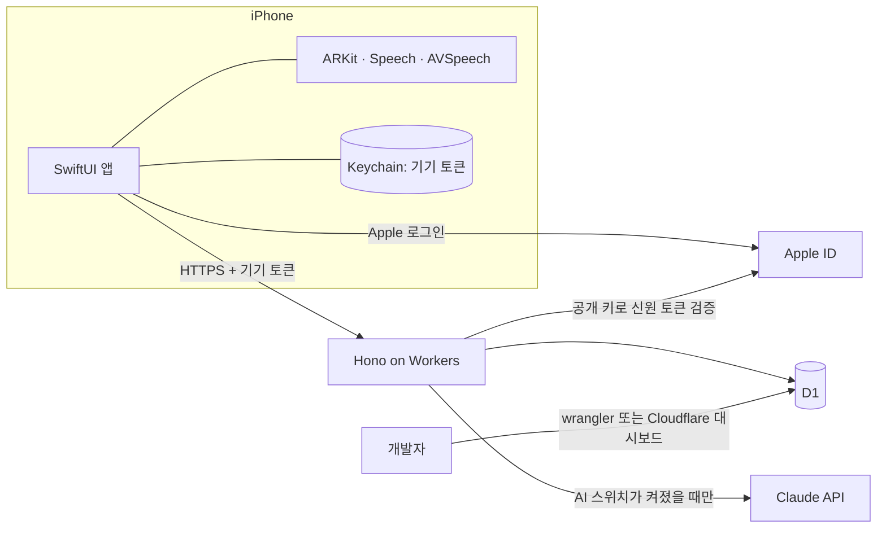

# ARCHITECTURE

## 1. 개요
就活一歩는 일본 취업·이직 준비생을 위한 iPhone 모의면접 앱이다. AI가 질문을 만들고, 사용자가 말로 답하면 답변의 구성과 논리를 AI가 평가하며, 면접 중 시선과 머리의 움직임을 함께 측정한다. 면접 일정 관리와 결과 분석 그래프도 제공한다.

- 이 저장소의 책임: iOS 앱, 앱과 서버가 공유하는 설계 문서(API 계약, 데이터 모델)
- 서버 저장소의 책임: 서버 코드, 마이그레이션, 서버 테스트와 배포. 별도 저장소로 분리한다(이름 미정, 생성 후 여기에 링크).
- 바깥의 서비스: Claude API(질문 생성·평가), Cloudflare(서버 실행·DB), Apple(로그인 신원 확인)
- 상용 서비스가 아니다. App Store에 출시하지 않고 공개 저장소의 소스를 직접 빌드해 설치한다.

## 2. 기술 스택
| 영역 | 선택 | 이유 |
|---|---|---|
| 앱 언어·UI | Swift 6, SwiftUI (iOS 18 이상) | iPhone 전용. 카메라·음성 기능을 Apple 공식 API로 바로 사용 |
| 시선·머리 측정 | ARKit Face Tracking | 시선 방향과 머리 각도를 기기 안에서 계산. 영상을 서버로 보내지 않음 |
| 로그인 | Sign in with Apple(AuthenticationServices), 로그인 없이 시작 | 사용자 결정. 둘 다 제공 |
| 음성 인식(STT) | Apple Speech (`ja-JP`) | 추가 비용 없음 |
| 음성 합성(TTS) | AVSpeechSynthesizer (`ja-JP`) | 추가 비용 없음 |
| 그래프 | Swift Charts | Apple 기본 제공. 외부 의존성 없음 |
| 서버 | TypeScript, Hono, Cloudflare Workers | 사용자 결정. 서버 관리 부담이 적음 |
| 데이터 저장 | Cloudflare D1 (SQLite) | 사용자 결정. Workers와 바로 연동 |
| AI | Claude API (`@anthropic-ai/sdk`), 기본 모델 `claude-opus-5-5` | 사용자 결정. 비밀 키는 서버에만 둠 |
| 테스트 | Swift Testing(앱), Vitest + `@cloudflare/vitest-pool-workers`(서버) | 각 플랫폼의 표준 도구 |
| 호스팅·배포 | Cloudflare Workers(서버), 소스 직접 빌드(앱) | TestFlight 없이 공개 저장소로 배포 |

## 3. 시스템 구성도


## 4. 디렉터리 구조
```
이 저장소
```
JobHuntFirstStep.xcodeproj   Xcode 프로젝트
JobHuntFirstStep/            앱 소스 (App, Features, Domain, Data, Sensors)
JobHuntFirstStepTests/       앱 테스트
Config/                      xcconfig. Local.xcconfig는 커밋하지 않음
docs/                        프로젝트 문서
```

서버 저장소
```
src/                         라우트, 서비스, 저장소, AI 호출
migrations/                  D1 마이그레이션 SQL
seed/                        개발용 시드
test/                        서버 테스트와 픽스처
wrangler.jsonc               Workers·D1 설정
```

## 5. 모듈·레이어와 의존 방향
### 앱
| 레이어·모듈 | 책임 | 의존 가능 대상 |
|---|---|---|
| Features | 화면과 화면 상태 | Domain, Sensors, Data |
| Sensors | 카메라 추적, STT, TTS | Domain |
| Data | API 호출, Keychain | Domain |
| Domain | 모델과 계산 규칙 | 없음 |

### 서버 (서버 저장소)
| 레이어·모듈 | 책임 | 의존 가능 대상 |
|---|---|---|
| routes | 요청 검증, 응답 변환 | services |
| services | 업무 규칙, AI 스위치 확인 | repositories, ai |
| repositories | D1 쿼리 | 없음 |
| ai | Claude 호출과 응답 스키마 | 없음 |

### API
모든 요청은 `Authorization: Bearer <기기 토큰>`을 보낸다. 오류 응답의 형식은 `{ "error": { "code", "message" } }`이다.

| 메서드·경로 | 용도 | AI 사용 |
|---|---|---|
| `POST /v1/auth/apple` | Apple 신원 토큰을 검증해 현재 기기를 Apple 계정에 연결 | 아니오 |
| `POST /v1/auth/logout` | 현재 기기 토큰을 무효화 | 아니오 |
| `GET /v1/me` | 로그인 상태 조회 | 아니오 |
| `GET /v1/status` | AI 스위치 상태 조회 | 아니오 |
| `POST /v1/interviews` | 면접 생성과 질문 생성 | 예 |
| `GET /v1/interviews` | 면접 기록 목록 | 아니오 |
| `GET /v1/interviews/:id` | 면접 상세 | 아니오 |
| `DELETE /v1/interviews/:id` | 면접 삭제 | 아니오 |
| `PUT /v1/interviews/:id/questions/:questionId/answer` | 답변과 측정값 저장 | 아니오 |
| `POST /v1/interviews/:id/evaluation` | 답변 평가 | 예 |
| `GET /v1/schedules?from&to` | 일정 조회 | 아니오 |
| `POST /v1/schedules` | 일정 추가 | 아니오 |
| `PUT /v1/schedules/:id` | 일정 수정 | 아니오 |
| `DELETE /v1/schedules/:id` | 일정 삭제 | 아니오 |
| `GET /v1/analytics?from&to` | 그래프용 집계 | 아니오 |

AI를 쓰는 경로는 스위치가 꺼져 있으면 Claude를 호출하지 않고 `503 AI_DISABLED`를 돌려준다.

## 6. 핵심 흐름
### 6.1 모의면접
1. 앱이 `GET /v1/status`로 AI 스위치를 확인한다. 꺼져 있으면 면접 시작을 막고 안내한다.
2. 사용자가 회사명(선택), 직무, 면접 유형, 질문 수를 입력한다.
3. `POST /v1/interviews`가 Claude로 일본어 질문을 만들어 저장하고 돌려준다.
4. 앱이 질문을 TTS로 읽고, 사용자의 말을 STT로 받아 적으며, ARKit으로 시선과 머리 움직임을 측정한다.
5. 답변마다 받아쓴 글과 측정 수치를 저장한다. 영상과 음성은 저장하거나 전송하지 않는다.
6. 마지막 답변 뒤 `POST /v1/interviews/:id/evaluation`이 답변별 구성·논리 점수와 피드백을 저장한다.
7. 평가 중 스위치가 꺼지거나 실패하면 답변은 그대로 두고, 나중에 평가를 다시 시도할 수 있다.

### 6.2 AI 스위치
1. 개발자가 D1의 `app_setting.ai_enabled` 값을 `1` 또는 `0`으로 바꾼다. 명령은 OPERATIONS.md 4절을 따른다.
2. 서버는 AI를 쓰는 요청마다 이 값을 읽으므로 다시 배포하지 않아도 바로 적용된다.
3. 켜진 동안에는 앱 안에서 사용 횟수를 제한하지 않는다. 기본값은 꺼짐이다.

### 6.3 시작과 Apple 로그인
1. 첫 실행 때 앱이 무작위 기기 토큰을 Keychain에 만들고 시작 화면을 보여준다.
2. "로그인 없이 시작"을 고르면 게스트로 사용한다. 서버는 토큰을 처음 받을 때 계정을 만든다.
3. Apple 로그인을 고르면 앱이 nonce(한 번만 쓰는 무작위 값)와 함께 Apple 신원 토큰을 받아 `POST /v1/auth/apple`로 보낸다.
4. 서버는 Apple 공개 키로 서명을 확인하고 `iss`, `aud`(허용된 번들 ID), `exp`, `nonce`를 검사한다. 이메일과 이름은 저장하지 않고 `sub`만 저장한다.
5. 이 Apple 계정이 처음이면 현재 게스트 계정에 `apple_sub`를 연결한다. 이미 있으면 게스트의 면접과 일정을 그 계정으로 옮기고, 게스트 계정을 지운 뒤 기기 토큰을 그 계정에 연결한다.
6. 로그아웃하면 서버의 토큰을 지우고 앱이 새 토큰을 만들어 시작 화면으로 돌아간다. 데이터는 Apple 계정에 남아 다시 로그인하면 볼 수 있다.

## 7. 설계 결정 기록
| 날짜 | 결정 | 이유 | 버린 대안 |
|---|---|---|---|
| 2026-11-06 | 서버를 별도 저장소로 분리하고, 설계 문서는 이 저장소에 하나만 둔다 | 사용자 결정. 문서를 두 곳에 두면 API 계약과 데이터 모델이 어긋나기 쉽다 | 한 저장소에 앱과 서버를 함께 두기 |
| 2026-11-06 | 개발자가 직접 빌드한 앱에서는 Apple 로그인을 켠다 | 개발자가 Apple Developer Program 계정을 보유하고 있다 | 게스트만 사용 |
| 2026-11-06 | Apple 로그인과 로그인 없이 시작을 모두 제공한다. Apple 로그인은 빌드 설정으로 켜는 선택 기능이다 | 사용자 결정. Apple 로그인은 유료 Apple Developer Program이 필요한 것으로 알려져 있어, 무료 계정 빌드에서는 끄고 게스트로 사용하게 한다. 구현 시 Apple 문서로 재확인한다 | 로그인 없음(이전 결정), Apple 로그인 필수 |
| 2026-11-06 | Claude 요청에 구조화된 출력(`output_config.format`)과 `fallbacks: "default"`를 사용한다 | 응답을 스키마로 검증하고, 안전 분류기의 오탐으로 인한 거절 시 면접이 끊기지 않게 한다 | 자유 텍스트 응답 파싱 |
| 2026-11-06 | 질문은 면접 시작 때 한 번에 만들고, 평가는 면접 끝에 한 번에 호출한다 | 첫 버전의 호출 횟수와 비용, 대기 시간을 줄인다 | 답변마다 꼬리질문 생성·평가 |
| 2026-11-06 | 시선·머리 측정에 ARKit을 사용한다 | 시선 방향 값을 바로 얻어 구현이 단순하다. 단, Face ID가 있는 iPhone에서만 동작하고 시뮬레이터에서는 시험할 수 없다 | Vision 프레임워크(모든 기기 가능, 시선 정확도 낮음) |
| 2026-11-06 | 기기 안에서 만든 무작위 토큰을 Keychain에 두고, 서버에는 해시만 저장한다 | 로그인 없이 사용자별 데이터를 구분한다 | 로그인, 추측 가능한 기기 식별자 |
| 2026-11-06 | 면접 일정·답변·분석 결과를 서버 D1에 저장한다 | 사용자 결정 | 기기 저장 |
| 2026-11-06 | AI 사용을 개발자가 D1 값으로 켜고 끄며, 켜진 동안 횟수 제한을 두지 않는다 | 사용자 결정. 시연할 때만 켜는 운영 방식. 관리자 API가 없어 공격 표면도 늘지 않는다 | 기기별 사용량 제한, 사용자 본인 API 키 |
| 2026-11-06 | 소스를 직접 빌드해 설치한다 | 사용자 결정. 비용이 들지 않는다 | TestFlight 공개 링크 |
