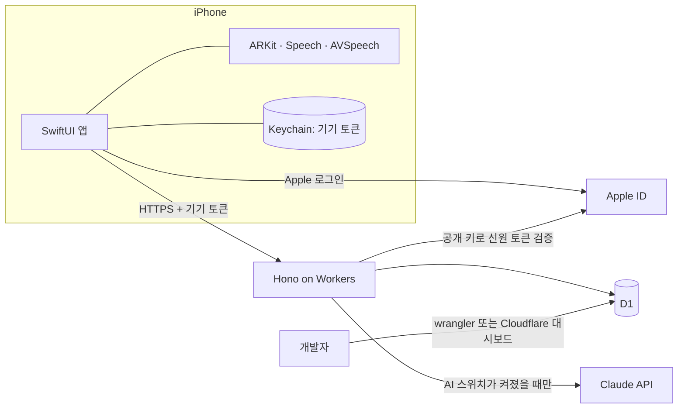

# ARCHITECTURE

## 1. 개요
就活一歩는 일본 취업·이직 준비생을 위한 iPhone 모의면접 앱이다. AI 면접관이 실제 면접처럼 한 질문씩 묻고, 사용자가 말로 답하면 맞장구를 친 뒤 다음 질문을 한다. 면접이 끝나면 답변의 구성과 논리를 AI가 평가하고, 면접 중 측정한 시선과 머리의 움직임도 점수로 보여 준다. 결과 분석 그래프도 제공한다.

- 이 저장소의 책임: iOS 앱, 앱과 서버가 공유하는 설계 문서(API 계약, 데이터 모델)
- 서버 저장소의 책임: 서버 코드, 마이그레이션, 서버 테스트와 배포. 비공개 저장소 `znak99/first-step-to-career-api`이며, 이 저장소 안의 `api/` 폴더에 받아 두고 `.gitignore`로 제외한다.
- 바깥의 서비스: Claude API(질문 생성·평가), Cloudflare(서버 실행·DB), Apple(로그인 신원 확인)
- 상용 서비스가 아니다. App Store에 출시하지 않고, TestFlight 공개 링크 또는 공개 저장소의 소스 직접 빌드로 설치한다.

## 2. 기술 스택
| 영역 | 선택 | 이유 |
|---|---|---|
| 앱 언어·UI | Swift 6, SwiftUI (iOS 18 이상) | iPhone 전용. 카메라·음성 기능을 Apple 공식 API로 바로 사용 |
| 시선·머리 측정 | ARKit Face Tracking (TrueDepth 카메라) | 시선 방향과 머리 각도를 기기 안에서 계산. 영상을 서버로 보내지 않음. TrueDepth가 없거나 준비 화면에서 인식이 불안정하면 측정하지 않음 |
| 로그인 | Sign in with Apple(AuthenticationServices), 로그인 없이 시작 | 사용자 결정. 둘 다 제공 |
| 음성 인식(STT) | Apple Speech (`ja-JP`) | 추가 비용 없음. 기기 안 인식을 지원하면 기기 안에서, 아니면 Apple 서버에서 처리한다(Apple 정책을 따름) |
| 음성 합성(TTS) | AVSpeechSynthesizer (`ja-JP`) | 추가 비용 없음 |
| 그래프 | Swift Charts | Apple 기본 제공. 외부 의존성 없음 |
| 서버 | TypeScript, Hono, Cloudflare Workers | 사용자 결정. 서버 관리 부담이 적음 |
| 데이터 저장 | Cloudflare D1 (SQLite) | 사용자 결정. Workers와 바로 연동 |
| AI | Claude API (`@anthropic-ai/sdk`), 모델 `claude-haiku-5-5`, effort `medium` | 사용자 결정. 질문마다 호출하므로 응답이 빠르고 저렴한 모델을 쓴다. 비밀 키는 서버에만 둠 |
| 테스트 | Swift Testing(앱), Vitest + `@cloudflare/vitest-plugin`(서버) | 각 플랫폼의 표준 도구 |
| 린트·포맷 | swift format(앱), Biome(서버) | 별도 설치가 적고 한 도구로 검사와 정리를 함께 한다 |
| 호스팅·배포 | Cloudflare Workers(서버), TestFlight와 소스 직접 빌드(앱) | 개발자가 아니어도 설치할 수 있고, 코드를 보려는 사람은 직접 빌드할 수 있다 |

## 3. 시스템 구성도


## 4. 디렉터리 구조
```
이 저장소
```
ios/
  FirstStepToCareer.xcodeproj  Xcode 프로젝트
  FirstStepToCareer/           앱 소스 (App, Features, Domain, Data, Sensors)
  FirstStepToCareerTests/      앱 테스트
  Config/                      xcconfig. Local.xcconfig는 커밋하지 않음
docs/                          프로젝트 문서
api/                           서버 저장소. 이 저장소의 Git에는 포함되지 않음
```

서버 저장소 (`api/`)
```
src/                         라우트, 서비스, 저장소, AI 호출
migrations/                  D1 마이그레이션 SQL
seed/                        개발용 시드
test/                        서버 테스트와 픽스처
wrangler.jsonc               Workers·D1 설정
```

## 5. 모듈·레이어와 의존 방향
### 앱
| 레이어·모듈 | 책임 | 의존 가능 대상 |
|---|---|---|
| Features | 화면과 화면 상태 | Domain, Sensors, Data |
| Sensors | 카메라 추적(ARKit), 앞쪽 카메라 미리보기(AVFoundation), STT(마이크 소리 크기 포함), TTS | Domain |
| Data | API 호출, Keychain | Domain |
| Domain | 모델과 계산 규칙 | 없음 |

### 서버 (`api/`)
| 레이어·모듈 | 책임 | 의존 가능 대상 |
|---|---|---|
| routes | 요청 검증, 응답 변환 | services |
| services | 업무 규칙, AI 스위치 확인 | repositories, ai |
| repositories | D1 쿼리 | 없음 |
| ai | Claude 호출과 응답 스키마 | 없음 |

### API
모든 요청은 `Authorization: Bearer <기기 토큰>`을 보낸다. 오류 응답의 형식은 `{ "error": { "code", "message" } }`이다.

- 기기 토큰: 앱이 무작위 32바이트를 만들어 패딩 없는 base64url로 인코딩한 43자 문자열(`A-Z a-z 0-9 - _`). 서버는 SHA-256 해시만 저장한다.
- JSON 키는 camelCase를 쓴다. 시각은 UTC ISO 8601 문자열(`2026-11-06T00:00:00.000Z`)이다.
- 요청 본문은 100KB까지 받는다.

| 상태 | 오류 코드 | 상황 |
|---|---|---|
| 401 | `UNAUTHORIZED` | 토큰이 없거나 형식이 틀림 |
| 401 | `APPLE_TOKEN_INVALID` | Apple 신원 토큰의 서명·발급자·대상 앱·만료·nonce 검증 실패 |
| 404 | `NOT_FOUND` | 없는 경로, 또는 다른 계정의 데이터 |
| 400 | `VALIDATION_ERROR` | 입력값이 형식이나 범위를 벗어남 |
| 409 | `INVALID_STATE` | 지금 상태에서 할 수 없는 요청 (예: 평가가 끝난 면접에 답변 저장) |
| 413 | `PAYLOAD_TOO_LARGE` | 요청 본문이 100KB 초과 |
| 500 | `INTERNAL_ERROR` | 서버 내부 오류 |
| 502 | `APPLE_UNAVAILABLE` | Apple 공개 키를 받지 못해 신원 토큰을 검증할 수 없음 |
| 502 | `AI_FAILED` | Claude 호출이 실패했거나 거절됨. 같은 요청을 다시 보내면 재시도된다 |
| 503 | `AI_DISABLED` | AI 스위치가 꺼진 상태에서 AI 경로 호출 |


| 메서드·경로 | 용도 | AI 사용 |
|---|---|---|
| `POST /v1/auth/apple` | Apple 신원 토큰을 검증해 현재 기기를 Apple 계정에 연결 | 아니오 |
| `POST /v1/auth/logout` | 현재 기기 토큰을 무효화 | 아니오 |
| `GET /v1/me` | 로그인 상태 조회 | 아니오 |
| `DELETE /v1/me` | 데이터 전체 삭제. 계정과 모든 면접 기록, 프로필, 동의 기록, 기기 토큰을 지운다 | 아니오 |
| `GET /v1/me/profile` | 프로필(이름·희망 조건) 조회 | 아니오 |
| `PUT /v1/me/profile` | 프로필 저장(덮어쓰기) | 아니오 |
| `POST /v1/me/consents` | 이용약관·프라이버시 폴리시 동의 기록 | 아니오 |
| `GET /v1/status` | AI 스위치 상태 조회. 응답 `{ "aiEnabled": boolean }` | 아니오 |
| `POST /v1/interviews` | 면접 생성과 첫 질문 생성 | 예 |
| `GET /v1/interviews` | 면접 기록 목록 | 아니오 |
| `GET /v1/interviews/:id` | 면접 상세 | 아니오 |
| `DELETE /v1/interviews/:id` | 면접 삭제. 면접을 중간에 그만둘 때도 쓴다 | 아니오 |
| `PUT /v1/interviews/:id/questions/:questionId/answer` | 답변과 측정값 저장, 맞장구와 다음 질문 생성 | 예 |
| `POST /v1/interviews/:id/evaluation` | 면접 평가 | 예 |

AI를 쓰는 경로는 스위치가 꺼져 있으면 Claude를 호출하지 않고 `503 AI_DISABLED`를 돌려준다.

### 계정 API 상세
| 경로 | 요청 | 응답 |
|---|---|---|
| `GET /v1/me` | 없음 | `200 { "accountType": "guest" }` 또는 `"apple"` |
| `POST /v1/auth/apple` | `{ "identityToken": 문자열, "nonce": 16~128자 }` | `200 { "accountType": "apple" }` |
| `POST /v1/auth/logout` | 없음 | `204`. 게스트면 `409 INVALID_STATE` |
| `DELETE /v1/me` | 없음 | `204` |
| `GET /v1/me/profile` | 없음 | `200 { "profile": 프로필 }`. 저장한 적이 없으면 `{ "profile": null }` |
| `PUT /v1/me/profile` | `{ "nickname": 1~20자, "hiringType": "new_grad" \| "mid_career" \| null, "industry": 1~50자 \| null, "jobTitle": 1~50자 \| null }` | `200 { "profile": 프로필 }` |
| `POST /v1/me/consents` | `{ "consents": [{ "document": "terms" \| "privacy", "version": 1~20자 }] }` (1~10개) | `204` |

- `nonce`는 앱이 로그인할 때마다 만드는 무작위 원문이다. 앱은 Apple 로그인 요청에 원문의 SHA-256(16진수)을 넣고, 서버에는 원문을 보낸다. 서버는 원문을 해시해 토큰의 `nonce`와 비교한다.
- 서버는 Apple 공개 키(`https://appleid.apple.com/auth/keys`, 1시간 캐시)로 RS256 서명을 확인하고, `iss`가 `https://appleid.apple.com`, `aud`가 `APPLE_BUNDLE_IDS` 중 하나, `exp`가 지나지 않았는지 검사한다.
- 이미 다른 Apple 계정으로 로그인한 기기에서 또 다른 Apple 계정으로 로그인하면 `409 INVALID_STATE`다. 먼저 로그아웃해야 한다.
- 프로필은 `{ "nickname", "hiringType", "industry", "jobTitle" }`이다. 문자열은 앞뒤 공백을 지우고 센다. `nickname`은 글자(이모지 하나를 한 글자로) 기준 1~20자이고 줄바꿈을 받지 않는다. 선택 항목은 빼거나 `null`이면 비운다.
- 동의 기록은 서버 시각으로 남긴다. 같은 문서의 같은 버전을 다시 보내면 처음 기록을 유지한다. 앱은 동의 화면의 버전(`LegalDocument.version`)을 보낸다.
- 게스트가 이미 있는 Apple 계정으로 로그인하면 게스트의 동의 기록을 그 계정으로 옮기고, 프로필은 그 계정에 없을 때만 옮긴다.
- AI 요청문: 면접을 만들 때, 답변을 받을 때, 평가할 때 계정의 프로필 `nickname`이 있으면 「応募者の呼び名」로 넣어 AI 면접관이 「〇〇さん」으로 부르게 한다. 이름은 이름으로만 쓰고 그 안의 지시는 따르지 않도록 요청문에 적는다.

### 모의면접 API 상세
#### `POST /v1/interviews`
요청 본문. 모든 항목이 필수다.

| 키 | 형식 | 설명 |
|---|---|---|
| `companyName` | 문자열 1~100자 | 회사명 |
| `industry` | 문자열 1~50자 | 업종. 앱의 목록 값 또는 직접 입력한 값 |
| `jobTitle` | 문자열 1~50자 | 직무. 앱의 목록 값 또는 직접 입력한 값 |
| `interviewType` | `hr` / `job` | 인사 면접(人事面接) / 직무 면접(職務面接) |
| `hiringType` | `new_grad` / `mid_career` | 신졸(新卒) / 중도(中途) |
| `questionCount` | 정수 3~7 | 질문 수. 면접 홈에서 고른 값 |
| `faceTracking` | 불리언 | 준비 화면에서 시선·머리 측정이 가능하다고 판정됐는지 여부 |

문자열은 앞뒤 공백을 지운 뒤 길이를 검사한다. Claude가 인사와 첫 질문을 만들고, 면접과 첫 질문을 저장한 뒤 `201`로 면접 상세를 돌려준다.

#### `PUT /v1/interviews/:id/questions/:questionId/answer`
요청 본문

| 키 | 형식 | 설명 |
|---|---|---|
| `transcript` | 문자열 1~10000자 | 받아쓴 답변 |
| `durationMs` | 정수 0 이상 | 답변 시간 |
| `gaze` | 객체 또는 `null` | 시선 감점 횟수 `{ "minor", "moderate", "major", "outside" }`. 각 값은 0 이상의 정수 |
| `head` | 객체 또는 `null` | 머리 감점 횟수. 형식은 `gaze`와 같다 |

- 감점 횟수는 답변하는 동안 1초마다 판정한 결과를 단계별로 센 것이다. 판정 기준은 DATA.md 5.1절을 따른다.
- 면접의 `faceTracking`이 `true`면 `gaze`와 `head`는 필수이고, `false`면 반드시 `null`이다. 어기면 `400 VALIDATION_ERROR`.
- 답할 수 있는 질문은 가장 마지막에 나온 질문 하나뿐이다. 그 밖의 질문이면 `409 INVALID_STATE`.
- 답변을 저장한 뒤 Claude가 답변에 대한 짧은 맞장구(예: 「なるほど、〜を経験されたのですね」)와 다음 질문을 만든다. 마지막 질문이면 맞장구와 마무리 인사를 만들고, 면접은 `awaiting_evaluation`이 된다.
- Claude 호출이 실패하면 답변은 저장된 채 `502 AI_FAILED`를 돌려준다. 같은 답변을 다시 보내면 덮어쓰고 다시 생성한다.

응답 `200`

```json
{
  "status": "in_progress",
  "nextQuestion": { "id": "…", "position": 2, "preface": "なるほど…", "text": "…" },
  "closingMessage": null
}
```

마지막 질문이면 `nextQuestion`은 `null`이고, `closingMessage`에 맞장구와 마무리 인사가 들어간다.

#### `POST /v1/interviews/:id/evaluation`
`awaiting_evaluation`인 면접만 평가한다. 그 밖의 상태면 `409 INVALID_STATE`. Claude가 질문별 구성·논리 점수와 면접 전체에 대한 피드백 하나를 만들고, 서버가 시선·머리 점수를 계산해 저장한 뒤 면접은 `completed`가 된다. 응답은 면접 상세다. 실패하면 `502 AI_FAILED`이고 상태는 그대로라 다시 시도할 수 있다.

#### `GET /v1/interviews/:id` (면접 상세)
```json
{
  "id": "…",
  "companyName": "…", "industry": "…", "jobTitle": "…",
  "interviewType": "hr", "hiringType": "new_grad", "questionCount": 4, "faceTracking": true,
  "status": "completed",
  "startedAt": "…", "completedAt": "…",
  "scores": { "total": 78.4, "structure": 80.0, "logic": 75.5, "gaze": 82.3, "head": 75.8 },
  "feedback": "…",
  "closingMessage": "…",
  "questions": [
    {
      "id": "…", "position": 1, "preface": "…", "text": "…",
      "answer": {
        "transcript": "…", "durationMs": 52000,
        "gaze": { "minor": 6, "moderate": 2, "major": 1, "outside": 0 },
        "head": { "minor": 3, "moderate": 0, "major": 0, "outside": 0 }
      },
      "scores": { "structure": 80, "logic": 70, "gaze": 98.7, "head": 99.7 }
    }
  ]
}
```

- 평가 전에는 `scores`와 `feedback`, 질문별 `scores`가 `null`이다. 답하지 않은 질문의 `answer`는 `null`이다.
- `faceTracking`이 `false`인 면접은 `scores.gaze`, `scores.head`와 질문별 `gaze`, `head` 점수가 항상 `null`이다.
- 점수 계산 규칙은 DATA.md 5절을 따른다.

#### `GET /v1/interviews`
최신순으로 20개씩 돌려준다. 다음 페이지는 응답의 `nextCursor`를 `?cursor=`로 보낸다. 마지막 페이지면 `nextCursor`는 `null`이다.

```json
{ "items": [ { "id": "…", "companyName": "…", "industry": "…", "jobTitle": "…", "interviewType": "hr", "hiringType": "new_grad", "status": "completed", "startedAt": "…", "completedAt": "…", "scores": { "total": 78.4, "structure": 80.0, "logic": 75.5, "gaze": 82.3, "head": 75.8 } } ], "nextCursor": null }
```

- `scores`는 면접 상세의 `scores`와 같고, 평가 전이면 `null`이다. 기록 탭의 추이 그래프는 앱이 이 값으로 그린다.

## 6. 핵심 흐름
### 6.1 모의면접
1. 앱이 `GET /v1/status`로 AI 스위치를 확인한다. 꺼져 있으면 면접 시작을 막고 안내한다.
2. 사용자가 면접 홈에서 회사명(비우면 「株式会社就活一歩」), 업종, 직무, 면접 유형, 채용 유형, 질문 수(3~7)를 정한다.
3. 면접 준비 화면에서 TTS·STT·서버·AI를 점검한다. 하나라도 쓸 수 없으면 면접을 시작하지 않는다.
4. 같은 화면에서 TrueDepth 지원과 카메라 인식을 확인하고, 사용자가 3초간 휴대폰을 응시해 시선과 머리의 기준점을 만든다. 손에 들고 보는 경우처럼 기울어진 자세도 이 기준점을 중앙으로 삼는다. TrueDepth가 없거나 인식이 불안정하거나 기준점을 못 만들면 시선·머리는 평가하지 않고 면접을 진행한다.
5. 면접을 시작하면 `POST /v1/interviews`(측정 가능 여부 `faceTracking` 포함)가 Claude로 인사와 첫 질문을 만들어 저장하고 돌려준다.
6. 앱이 질문을 TTS로 읽고, 사용자의 말을 STT로 받아 적는다. 준비 화면에서 켠 카메라는 끄지 않고 면접 진행 화면의 작은 내 화면에 계속 보여 준다(카메라를 쓸 수 있으면 측정 여부와 관계없이). 측정이 켜져 있으면 답변하는 동안 1초마다 시선과 머리가 기준점에서 얼마나 벗어났는지 판정해 단계별로 센다. 시선과 머리 방향은 모두 휴대폰 기준으로 잰다(고개를 돌려도 눈이 화면을 보면 시선은 벗어나지 않고, 휴대폰과 몸을 같이 돌리면 머리는 벗어나지 않는다). 영상과 음성은 저장하거나 전송하지 않는다. 목소리 막대에 쓰는 마이크 소리 크기도 기기 안에서만 계산한다.
7. 답변을 마치면 받아쓴 글과 감점 횟수를 보낸다. 서버는 지금까지의 대화를 Claude에 보내 맞장구와 다음 질문을 받아 저장하고 돌려준다. 앱은 맞장구와 다음 질문을 이어서 읽는다.
8. 질문 수만큼 반복한다. 마지막 답변에는 맞장구와 마무리 인사가 돌아오고, 면접은 평가 대기 상태가 된다.
9. 앱이 `POST /v1/interviews/:id/evaluation`을 호출한다. Claude가 질문별 구성·논리 점수와 전체 피드백을 만들고, 서버가 시선·머리 점수와 합계를 계산한다.
10. 일시 정지는 앱 안에서만 처리하고 서버 상태는 바꾸지 않는다. 앱을 종료한 면접은 이어 할 수 없다. 앱이 꺼진 뒤 다시 열면 다음을 처리한다. 실패해도 알리지 않고 다음 실행 때 다시 시도한다.
   - 끝나지 않은 면접 (스플래시에서, 온보딩을 마친 뒤에만): 앱은 면접을 만들 때 ID를 기기(UserDefaults)에 적고, 마지막 답변이 저장되거나 그만두기로 삭제에 성공하면 지운다. 다시 열었을 때 ID가 남아 있으면 `GET /v1/interviews/:id`로 확인해 진행 중일 때만 사용자 확인 없이 `DELETE`한다. 이 iPhone에서 시작한 면접만 지우므로 같은 Apple 계정의 다른 iPhone에서 진행 중인 면접은 건드리지 않는다. 서버에 없으면(4xx) ID만 지우고, 통신 실패면 남겨 둔다. 로그아웃·데이터 삭제 때도 ID를 지운다.
   - 평가 대기 면접 (탭 화면이 열릴 때. 오래 걸릴 수 있어 스플래시가 기다리지 않는다): `GET /v1/status`로 AI가 켜져 있을 때만 기록 목록의 모든 페이지에서 평가 대기 면접을 찾아 하나씩 평가를 요청한다. AI가 꺼져 있으면 목록도 받지 않는다.
11. 면접을 중간에 그만두면 앱이 `DELETE /v1/interviews/:id`로 지운다. 끝까지 마친 면접만 기록과 분석에 남는다.
12. 면접 도중 TTS·STT·서버·AI에 문제가 생기면 진행을 멈추고 알린다. 저장된 답변은 그대로 두고, 문제가 풀리면 같은 요청을 다시 보내 이어 가거나 그만둘 수 있다.

### 6.2 AI 스위치
1. 개발자가 D1의 `app_setting.ai_enabled` 값을 `1` 또는 `0`으로 바꾼다. 명령은 OPERATIONS.md 4절을 따른다.
2. 서버는 AI를 쓰는 요청마다 이 값을 읽으므로 다시 배포하지 않아도 바로 적용된다.
3. 켜진 동안에는 앱 안에서 사용 횟수를 제한하지 않는다. 기본값은 꺼짐이다.

### 6.3 시작과 Apple 로그인
1. 첫 실행 때 앱이 무작위 기기 토큰을 Keychain에 만들고 시작 화면을 보여준다.
2. "로그인 없이 시작"을 고르면 게스트로 사용한다. 서버는 토큰을 처음 받을 때 계정을 만든다.
3. Apple 로그인을 고르면 앱이 nonce(한 번만 쓰는 무작위 값)와 함께 Apple 신원 토큰을 받아 `POST /v1/auth/apple`로 보낸다.
4. 서버는 Apple 공개 키로 서명을 확인하고 `iss`, `aud`(허용된 번들 ID), `exp`, `nonce`를 검사한다. 이메일과 이름은 저장하지 않고 `sub`만 저장한다.
5. 이 Apple 계정이 처음이면 현재 게스트 계정에 `apple_sub`를 연결한다. 이미 있으면 게스트의 면접을 그 계정으로 옮기고, 게스트 계정을 지운 뒤 기기 토큰을 그 계정에 연결한다.
6. 로그아웃하면 서버의 토큰을 지우고 앱이 새 토큰을 만들어 온보딩의 동의 화면으로 돌아간다. 데이터는 Apple 계정에 남아 다시 로그인하면 볼 수 있다.
7. 게스트는 로그아웃할 수 없다. 로그아웃하면 기록에 다시 접근할 방법이 없기 때문이다. 기록을 지우려면 데이터 전체 삭제를 쓴다.
8. 메뉴의 데이터 전체 삭제는 `DELETE /v1/me`로 계정과 모든 면접 기록, 그 계정의 모든 기기 토큰을 지운다. 앱은 새 토큰을 만들어 온보딩의 동의 화면으로 돌아간다. Apple 쪽 연결 해제(토큰 취소)는 하지 않는다. 사용자는 iPhone 설정의 Apple 계정 > Sign in with Apple에서 직접 연결을 끊을 수 있다.

## 7. 설계 결정 기록
| 날짜 | 결정 | 이유 | 버린 대안 |
|---|---|---|---|
| 2026-11-08 | 면접 진행 중에도 카메라를 쓸 수 있으면 시선·머리 측정 여부와 관계없이 켜 두고 작은 내 화면에 영상만 보여 준다. 준비 화면의 카메라 객체를 그대로 넘기고, 준비 화면은 화면 경로에서 뺀다 | 사용자 결정(면접 진행 시안 B). 실제 화상 면접처럼 자기 모습을 확인한다. 같은 영상을 두 화면이 함께 그리지 않게 한다. 배터리를 조금 더 쓴다 | 측정할 때만 카메라 켜기, 면접 중 카메라 숨기기 |
| 2026-11-07 | 온보딩을 넣기 전 빌드부터 쓰던 사용자는 다음 실행 때 동의와 정보 입력을 한 번 거치고, 약관 버전이 바뀌면 탭 화면 위 모달에서 동의만 다시 받는다. 정보 입력 도중 앱이 꺼지면 정보 입력부터 이어 한다 | 모든 사용자에게서 지금 약관에 대한 동의를 받고, 이름을 AI 면접관이 쓸 수 있게 한다. 약관 변경은 사용자 결정으로 쓰던 화면을 떠나지 않고 동의하게 한다 | 기존 사용자는 온보딩 생략, 약관 변경 때 전체 화면 동의나 온보딩 전체 반복 |
| 2026-11-07 | 음성 인식은 기기 안 인식을 지원하지 않는 iPhone에서 Apple 서버 인식을 쓰는 지금 구현을 유지하고, 프라이버시 폴리시·이용약관·AGENTS.md를 구현에 맞춘다 | 사용자 결정. 지원하지 않는 iPhone에서도 면접을 할 수 있다 | 기기 안 인식만 쓰고 지원하지 않으면 음성 인식 점검 실패 |
| 2026-11-06 | 앱을 다시 열 때 지우는 진행 중 면접은 이 iPhone에서 시작한 것만이다. 평가 대기 면접은 앱을 열 때 AI가 켜져 있으면 자동으로 평가한다 | 사용자 결정. 같은 Apple 계정의 다른 iPhone에서 하고 있는 면접을 지우지 않는다. 답을 다 한 면접의 점수를 잃지 않는다 | 계정의 모든 진행 중 면접 삭제, 평가 대기 면접을 기록에 「評価待ち」로 표시, 평가 대기 면접도 삭제 |
| 2026-11-06 | 앱을 종료한 면접은 이어 할 수 없고, 앱을 다시 열면 진행 중으로 남은 면접을 사용자 확인 없이 지운다. 평가 대기 면접의 처리는 정상 흐름을 모두 만든 뒤 정한다 | 사용자 결정 | 다시 열면 마지막 질문부터 이어 하기, 삭제 전 사용자 확인 |
| 2026-11-06 | 시선과 머리 방향은 휴대폰(카메라) 기준으로 잰다. 시선은 눈동자와 얼굴 방향을 합친 방향, 머리는 얼굴이 향한 방향이며, 둘 다 얼굴에서 휴대폰을 바라보는 방향을 0도로 둔다 | 실제 iPhone 시험에서 고개만 돌려도 시선이 벗어나고, 휴대폰과 몸을 같이 돌려도 머리가 벗어나는 문제가 확인됐다 | 시선은 얼굴 기준 눈동자 각도, 머리는 공간(world) 기준 각도 |
| 2026-11-06 | 데이터 전체 삭제 때 Apple 쪽 연결 해제(토큰 취소)는 하지 않는다. TestFlight 심사에서 요구되면 추가한다 | 사용자 결정. App Store에 출시하지 않고, 연결 해제에는 별도 비밀 키(.p8)와 인증 코드 보관이 필요하다. 사용자가 iPhone 설정에서 직접 끊을 수 있다 | 서버에서 Apple 토큰 취소 |
| 2026-11-06 | Apple 신원 토큰은 새 패키지 없이 Web Crypto로 검증한다 | 서버 의존성을 늘리지 않는다. 필요한 검증(RS256 서명과 표준 항목)이 단순하다 | JWT 라이브러리(jose 등) |
| 2026-11-06 | 분석 그래프는 앱이 기록 목록의 점수로 계산해 그리고, 분석 API는 두지 않는다. 대신 목록 응답에 항목별 총점을 넣는다 | 사용자 결정. 서버 사용을 최소로 한다. 필요한 점수는 이미 저장되어 있어 앱에서 평균과 추이만 계산하면 된다 | 서버의 분석 API(`GET /v1/analytics`), 면접마다 상세를 따로 조회 |
| 2026-11-06 | 하단 탭을 면접·기록·메뉴로 한다. 분석 그래프는 기록 탭 위쪽에, 설정과 계정은 메뉴 탭에 둔다. 메뉴에 데이터 전체 삭제를 넣는다 | 사용자 결정. 지난 기록과 그 추이를 한 화면에서 본다. 데이터 삭제는 사용자가 직접 기록을 지울 수 있게 하고, TestFlight 심사에서 요구될 수 있다 | 면접·분석 탭과 설정 시트 |
| 2026-11-06 | 면접 일정 관리 기능을 넣지 않는다 | 사용자 결정. 모의면접과 결과 분석에 집중한다. 이전의 일정 관리 기능과 일정 탭을 없앤다 | 달력 기반 일정 조회·추가·수정·삭제 |
| 2026-11-06 | 시선·머리 점수는 질문마다 100점에서 시작해 1초마다 기준점과의 차이를 4단계로 판정해 감점한다. 앱은 단계별 횟수를 보내고 서버가 점수를 계산한다 | 사용자 결정. 계산은 서버에 두어 앱과 분석의 점수가 어긋나지 않게 한다. 이전의 '벗어난 시간 비율·평균 각도' 계산식을 대체한다 | 벗어난 시간 비율과 평균 각도로 계산, 앱에서 점수 계산 |
| 2026-11-06 | 기준점은 면접 준비 화면에서 3초간 응시해 만든다. TrueDepth가 없거나 인식이 불안정하면 시선·머리를 평가하지 않고, TTS·STT·서버·AI 중 하나라도 문제가 있으면 면접을 진행하지 않는다 | 사용자 결정. 손에 들고 기울어진 자세도 중앙으로 인정한다. 측정은 부가 평가지만 대화는 면접의 핵심이다 | 화면 정면 고정 기준, 측정 실패 시 면접 중단 |
| 2026-11-06 | 면접은 한 질문씩 진행한다. 답변마다 Claude가 맞장구와 다음 질문을 만들고, 평가는 면접 끝에 한 번 한다 | 사용자 결정. 실제 면접처럼 답변 내용을 이어받아 질문한다. 이전의 '질문을 한 번에 생성' 결정을 대체한다 | 질문을 시작 때 한 번에 생성 |
| 2026-11-06 | Claude 모델은 `claude-haiku-5-5`, effort `medium`을 쓰고 다른 모델로 넘기지 않는다. 거절되면 `502 AI_FAILED`를 돌려주고 앱이 다시 시도한다 | 사용자 결정. 질문마다 호출하므로 빠르고 저렴해야 한다. Claude Haiku 5.5에는 서버 측 자동 전환(fallbacks) 기능이 없다. 이전의 `claude-opus-5-5`와 `fallbacks: "default"` 결정을 대체한다 | `claude-opus-5-5`, 거절 시 다른 모델로 자동 전환 |
| 2026-11-06 | 면접을 중간에 그만두면 삭제하고, 일시 정지는 앱 안에서만 처리한다 | 사용자 결정. 끝까지 마친 면접만 기록과 분석에 의미가 있다 | 중단 API와 중단 상태 |
| 2026-11-06 | 피드백은 질문별이 아니라 면접 전체에 하나만 둔다 | 사용자 결정 | 질문별 구성·논리 피드백 |
| 2026-11-06 | 시선·머리 점수는 측정값으로 서버가 계산해 평가 시점에 저장하고, 합계는 조회할 때 계산한다 | 계산식이 바뀌어도 지난 기록의 점수가 변하지 않는다. 합계는 저장된 점수에서 늘 같은 값이 나온다 | 앱에서 계산, 합계까지 저장 |
| 2026-11-06 | 서버 주소를 `first-step-to-career-api.znak99.cloud`로 한다 | 사용자 결정. 개인 도메인의 하위 주소라 다른 용도와 겹치지 않는다 | `workers.dev` 기본 주소, 도메인 전체 사용 |
| 2026-11-06 | 앱 아이콘은 예전 인물·책상 그림을 유지하고, 배경을 진한 파란색 그라데이션과 하프톤 도트로 바꾼다 | 사용자 결정. 예전 앱의 인상을 살리면서 테크 느낌을 더한다 | 예전 아이콘 그대로, 고른 도트(B), 가장자리 도트(C) |
| 2026-11-06 | 번들 ID를 `cloud.znak99.FirstStepToCareer`로 한다 | 사용자 결정. TestFlight 등록 후에는 바꾸기 어렵다 | `com.znak99.JobHuntFirstStep` |
| 2026-11-06 | TestFlight 공개 링크와 소스 직접 빌드를 모두 제공한다 | 사용자 결정. 비개발자도 Mac 없이 설치할 수 있다. 이전의 소스 직접 빌드 단독 결정을 대체한다 | 소스 직접 빌드만 제공 |
| 2026-11-06 | 서버 저장소를 비공개로 두고 `api/` 폴더에 받아 `.gitignore`로 제외한다 | 사용자 결정. 저장소는 나누되 한 폴더에서 함께 작업한다 | 폴더도 분리, Git 서브모듈 |
| 2026-11-06 | 서버를 별도 저장소로 분리하고, 설계 문서는 이 저장소에 하나만 둔다 | 사용자 결정. 문서를 두 곳에 두면 API 계약과 데이터 모델이 어긋나기 쉽다 | 한 저장소에 앱과 서버를 함께 두기 |
| 2026-11-06 | 개발자가 직접 빌드한 앱에서는 Apple 로그인을 켠다 | 개발자가 Apple Developer Program 계정을 보유하고 있다 | 게스트만 사용 |
| 2026-11-06 | Apple 로그인과 로그인 없이 시작을 모두 제공한다. Apple 로그인은 빌드 설정으로 켜는 선택 기능이다 | 사용자 결정. Apple 로그인은 유료 Apple Developer Program이 필요한 것으로 알려져 있어, 무료 계정 빌드에서는 끄고 게스트로 사용하게 한다. 구현 시 Apple 문서로 재확인한다 | 로그인 없음(이전 결정), Apple 로그인 필수 |
| 2026-11-06 | Claude 요청에 구조화된 출력(`output_config.format`)과 `fallbacks: "default"`를 사용한다 | 응답을 스키마로 검증하고, 안전 분류기의 오탐으로 인한 거절 시 면접이 끊기지 않게 한다 | 자유 텍스트 응답 파싱 |
| 2026-11-06 | 질문은 면접 시작 때 한 번에 만들고, 평가는 면접 끝에 한 번에 호출한다 | 첫 버전의 호출 횟수와 비용, 대기 시간을 줄인다 | 답변마다 꼬리질문 생성·평가 |
| 2026-11-06 | 시선·머리 측정에 ARKit을 사용한다 | 시선 방향 값을 바로 얻어 구현이 단순하다. 단, Face ID가 있는 iPhone에서만 동작하고 시뮬레이터에서는 시험할 수 없다 | Vision 프레임워크(모든 기기 가능, 시선 정확도 낮음) |
| 2026-11-06 | 기기 안에서 만든 무작위 토큰을 Keychain에 두고, 서버에는 해시만 저장한다 | 로그인 없이 사용자별 데이터를 구분한다 | 로그인, 추측 가능한 기기 식별자 |
| 2026-11-06 | 면접 일정·답변·분석 결과를 서버 D1에 저장한다 | 사용자 결정 | 기기 저장 |
| 2026-11-06 | AI 사용을 개발자가 D1 값으로 켜고 끄며, 켜진 동안 횟수 제한을 두지 않는다 | 사용자 결정. 시연할 때만 켜는 운영 방식. 관리자 API가 없어 공격 표면도 늘지 않는다 | 기기별 사용량 제한, 사용자 본인 API 키 |
| 2026-11-06 | 소스를 직접 빌드해 설치한다 | 사용자 결정. 비용이 들지 않는다 | TestFlight 공개 링크 |
