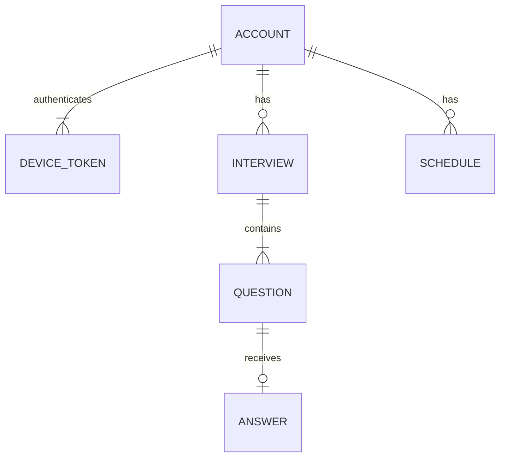

# DATA

## 1. 개요
| 저장소 | 종류 | 접근 방식 | 용도 |
|---|---|---|---|
| Cloudflare D1 | SQLite | Workers D1 바인딩 + 직접 SQL | 면접, 답변, 평가, 일정, AI 스위치 |
| iOS Keychain | 기기 내 보안 저장소 | Security 프레임워크 | 기기 토큰 |

영상과 음성은 어디에도 저장하지 않는다.

## 2. 엔티티 목록
| 엔티티 | 설명 | 저장소 |
|---|---|---|
| account | 사용자. 게스트이거나 Apple 계정에 연결됨 | D1 |
| device_token | 기기별 인증 토큰. 한 계정에 여러 개 가능 | D1 |
| interview | 모의면접 1회 | D1 |
| question | 면접의 질문 | D1 |
| answer | 질문에 대한 답변, 측정값, 질문별 점수 | D1 |
| schedule | 면접 일정 | D1 |
| app_setting | 앱 전체 설정. AI 스위치 포함 | D1 |
| 기기 토큰 원본 | 서버 인증에 쓰는 무작위 값 | Keychain |

## 3. ERD

## 4. 엔티티 상세
시각은 모두 UTC ISO 8601 문자열로 저장하고, 화면에 보여줄 때 기기 시간대로 바꾼다.

### 4.1 account
| 컬럼 | 타입 | 제약 | 설명 |
|---|---|---|---|
| id | TEXT | PK | UUID |
| apple_sub | TEXT | NULL 허용, UNIQUE | Apple 사용자 식별자. NULL이면 게스트 |
| created_at | TEXT | NOT NULL | 생성 시각 |

### 4.1.1 device_token
| 컬럼 | 타입 | 제약 | 설명 |
|---|---|---|---|
| token_hash | TEXT | PK | 기기 토큰의 SHA-256 해시 |
| account_id | TEXT | FK, NOT NULL | account.id |
| created_at | TEXT | NOT NULL | 처음 요청한 시각 |
| last_seen_at | TEXT | NOT NULL | 마지막 요청 시각. 쓰기를 줄이려고 1시간이 지났을 때만 갱신 |

### 4.2 interview
| 컬럼 | 타입 | 제약 | 설명 |
|---|---|---|---|
| id | TEXT | PK | UUID |
| account_id | TEXT | FK, NOT NULL | account.id |
| company_name | TEXT | NOT NULL, 1~100자 | 회사명 |
| industry | TEXT | NOT NULL, 1~50자 | 업종 |
| job_title | TEXT | NOT NULL, 1~50자 | 직무 |
| interview_type | TEXT | NOT NULL | `hr`(인사 면접) / `job`(직무 면접) |
| hiring_type | TEXT | NOT NULL | `new_grad`(新卒) / `mid_career`(中途) |
| question_count | INTEGER | NOT NULL, 3~7 | 질문 수 |
| face_tracking | INTEGER | NOT NULL, 0 또는 1 | 시선·머리 측정 여부. 준비 화면의 판정 결과 |
| status | TEXT | NOT NULL | 5절의 상태 |
| closing_message | TEXT | NULL 허용 | 마지막 답변 뒤의 맞장구와 마무리 인사 |
| feedback | TEXT | NULL 허용 | 면접 전체에 대한 AI 피드백(일본어) |
| started_at | TEXT | NOT NULL | 시작 시각 |
| completed_at | TEXT | NULL 허용 | 평가 완료 시각 |

### 4.3 question
| 컬럼 | 타입 | 제약 | 설명 |
|---|---|---|---|
| id | TEXT | PK | UUID |
| interview_id | TEXT | FK, NOT NULL | interview.id |
| position | INTEGER | NOT NULL, 1부터. `(interview_id, position)` UNIQUE | 질문 순서 |
| preface | TEXT | NULL 허용 | 질문 앞에 읽는 말. 첫 질문은 인사, 그 뒤는 앞 답변에 대한 맞장구 |
| text | TEXT | NOT NULL | 일본어 질문 |

### 4.4 answer
| 컬럼 | 타입 | 제약 | 설명 |
|---|---|---|---|
| question_id | TEXT | PK, FK | question.id |
| transcript | TEXT | NOT NULL, 10000자 이하 | STT로 받아쓴 답변 |
| duration_ms | INTEGER | NOT NULL, 0 이상 | 답변 시간 |
| gaze_minor / gaze_moderate / gaze_major / gaze_outside | INTEGER | NULL 허용, 0 이상 | 시선 감점 단계별 횟수. 측정하지 않으면 모두 NULL |
| head_minor / head_moderate / head_major / head_outside | INTEGER | NULL 허용, 0 이상 | 머리 감점 단계별 횟수. 측정하지 않으면 모두 NULL |
| structure_score | INTEGER | NULL 허용, 0~100 | 답변 구성 점수. 평가 때 Claude가 매김 |
| logic_score | INTEGER | NULL 허용, 0~100 | 답변 논리 점수. 평가 때 Claude가 매김 |
| gaze_score | REAL | NULL 허용, 0~100 | 시선 점수. 평가 때 서버가 계산 |
| head_score | REAL | NULL 허용, 0~100 | 머리 움직임 점수. 평가 때 서버가 계산 |
| evaluated_at | TEXT | NULL 허용 | 평가 시각 |
| answered_at | TEXT | NOT NULL | 답변 저장 시각 |

### 4.5 schedule
| 컬럼 | 타입 | 제약 | 설명 |
|---|---|---|---|
| id | TEXT | PK | UUID |
| account_id | TEXT | FK, NOT NULL | account.id |
| title | TEXT | NOT NULL, 1~100자 | 일정 이름 |
| starts_at | TEXT | NOT NULL | 시작 시각 |
| ends_at | TEXT | NULL 허용, starts_at 이후 | 종료 시각 |
| location | TEXT | NULL 허용, 200자 이하 | 장소 또는 온라인 주소 |
| memo | TEXT | NULL 허용, 2000자 이하 | 메모 |
| created_at | TEXT | NOT NULL | 생성 시각 |
| updated_at | TEXT | NOT NULL | 수정 시각 |

### 4.6 app_setting
| 컬럼 | 타입 | 제약 | 설명 |
|---|---|---|---|
| key | TEXT | PK | 설정 이름 |
| value | TEXT | NOT NULL | 설정 값 |
| updated_at | TEXT | NOT NULL | 수정 시각 |

## 5. 관계와 제약 조건
- `interview.status`의 전이: `in_progress` → `awaiting_evaluation` → `completed`만 허용한다. 중간에 그만둔 면접은 상태를 바꾸지 않고 삭제한다.
- 질문은 한 번에 하나씩 추가된다. `in_progress`인 면접에서 답할 수 있는 것은 가장 큰 `position`의 질문뿐이다. 질문 수는 `question_count`를 넘지 않는다.

### 5.1 점수 계산
모든 점수는 0~100이다. 화면에 보여 주는 값과 합계는 소수점 첫째 자리까지 반올림한다.

| 점수 | 계산 |
|---|---|
| 구성·논리 (질문별) | Claude가 정수로 매긴다 |
| 시선·머리 (질문별) | `max(0, 100 − 0.1 × minor − 0.2 × moderate − 0.3 × major − 0.5 × outside)` |
| 항목별 총점 | 질문별 점수의 평균 |
| 면접 총점 | 4개 항목별 총점의 평균 |

- `face_tracking`이 0인 면접은 시선·머리 점수와 그 항목별 총점이 `null`이고, 면접 총점은 구성·논리 2개 항목의 평균이다.

### 5.2 시선·머리 감점 판정 (앱)
답변하는 동안 1초마다 한 프레임을 보고, 준비 화면에서 만든 기준점에서 벗어난 정도를 아래 단계로 판정한다. 기준 이내면 감점하지 않는다.

| 단계 | 감점 | 시선 (기준점과의 각도) | 머리 (기준점과의 각도) |
|---|---|---|---|
| 조금 (`minor`) | 0.1 | 5° 이상 10° 미만 | 5° 이상 10° 미만 |
| 꽤 (`moderate`) | 0.2 | 10° 이상 15° 미만 | 10° 이상 20° 미만 |
| 많이 (`major`) | 0.3 | 15° 이상 | 20° 이상 30° 미만 |
| 밖 (`outside`) | 0.5 | 시선이 화면 밖이거나 얼굴을 찾지 못함 | 30° 이상이거나 얼굴을 찾지 못함 |

- 단계별 감점(0.1·0.2·0.3·0.5)은 사용자 결정이다. 각도 기준은 첫 값이며, 실제 iPhone으로 시험한 뒤 조정한다. 바꾸면 이 표와 설계 결정 기록을 함께 고친다.
- 각도는 앱 안에서만 쓰고 서버에는 단계별 횟수만 보낸다.
- 삭제는 연쇄 삭제다. account → device_token·interview·schedule, interview → question → answer.
- Apple 이메일과 이름은 저장하지 않는다.
- 게스트가 이미 있는 Apple 계정으로 로그인하면 면접과 일정을 그 계정으로 옮기고 게스트 계정을 지운다. 이 작업은 하나의 트랜잭션(D1 batch)으로 처리한다.
- 모든 조회와 변경은 인증된 계정의 데이터로 범위를 제한한다. 다른 계정의 데이터는 존재 여부도 알리지 않고 404를 돌려준다.
- 게스트가 기기 토큰을 잃으면 서버의 데이터에 다시 접근할 수 없다. 기기를 바꾸거나, Keychain이 지워지거나, 빌드의 서명 팀을 바꾸면 이런 일이 생긴다.
- Apple 계정 사용자는 다른 기기에서 로그인해 같은 데이터를 볼 수 있다. 단, Apple의 `sub`는 개발자 팀마다 달라서 서명 팀이 다른 빌드에서는 다른 계정이 된다.
- 답변 원문은 개인정보가 될 수 있다. 서버 관리자는 D1에서 원문을 볼 수 있고, 평가할 때 Claude API로 전송된다. 이 사실을 README와 앱 안에 알린다.

## 6. 마이그레이션
- 도구: Wrangler D1 migrations
- 파일 위치·이름 규칙: `api/migrations/NNNN_설명.sql`
- 현재 마이그레이션: `0001_init.sql`(계정·기기 토큰·앱 설정), `0002_interview.sql`(면접·질문·답변)
- 적용 명령: `api/`에서 `npx wrangler d1 migrations apply first-step-to-career --local` (운영은 `--remote`)
- 롤백 방법: 자동 롤백이 없다. 되돌리는 내용을 새 마이그레이션으로 추가한다.

## 7. 시드·초기 데이터
- 개발용 시드: `api/migrations/`에 넣지 않고 `api/seed/dev.sql`에 둔다.
- 필수 기준 데이터: `app_setting`의 `ai_enabled = '0'`을 첫 마이그레이션(`api/migrations/0001_init.sql`)에 포함한다. 값이 `'1'`일 때만 켜짐이고, 그 밖의 값이나 행이 없으면 꺼짐으로 본다.

### 7.1 테스트용 데이터
기능을 만들 때 해당 데이터를 함께 추가하고 위치를 적는다.

| 기법 | 넣어야 할 데이터 | 위치 |
|---|---|---|
| 경계값 | 질문 수 2·3·7·8, 점수 -1·0·100·101, 감점 횟수 -1·0, 감점 합이 100을 넘는 경우(0점), 토큰 42·43·44자, 요청 본문 100KB·100KB+1바이트, 마지막 접속 갱신 1시간 직전·직후 | `api/test/device-auth.test.ts`, `api/test/body-limit.test.ts`, `api/test/interviews.test.ts`, `api/test/answers.test.ts`, `api/test/scoring.test.ts`, `api/test/migrations.test.ts` |
| 문자열 길이 | 빈 문자열, 최소 길이, 최대 길이, 최대 초과 | `api/test/interviews.test.ts`, `api/test/answers.test.ts` |
| 특수 문자 | 따옴표, 공백만, 앞뒤 공백, 줄바꿈, 이모지, 한글·일본어, `< > ' " ; --` | `api/test/device-auth.test.ts`(토큰), `api/test/interviews.test.ts`, `api/test/answers.test.ts` |
| 형식 | 잘못된 날짜와 UUID, `ends_at`이 `starts_at`보다 이른 일정 | |
| 수량 | 면접·일정 0건, 1건, 한 페이지(20건)를 넘는 다수, 같은 질문에 답변 재전송, 이미 지나간 질문에 답변 | `api/test/interviews.test.ts`, `api/test/answers.test.ts` (일정은 일정 API에서 추가) |
| 상태 | 면접의 모든 상태값, 허용되지 않는 상태 전이, Claude 실패 뒤 재시도, `faceTracking` 켜짐·꺼짐과 측정값의 불일치, AI 스위치 켜짐·꺼짐·잘못된 값·행 없음 | `api/test/ai-switch.test.ts`, `api/test/answers.test.ts`, `api/test/evaluation.test.ts` |
| 동등 분할 | 유효·무효 입력 대표 사례, 다른 계정의 데이터 접근, 토큰 없음·잘못된 토큰, Apple 토큰의 서명·`aud`·`exp`·`nonce` 오류, 게스트 데이터가 있는 상태의 기존 Apple 계정 로그인 | `api/test/device-auth.test.ts`, `api/test/interviews.test.ts`, `api/test/answers.test.ts`, `api/test/evaluation.test.ts` (Apple 토큰은 Apple 로그인 API에서 추가) |
