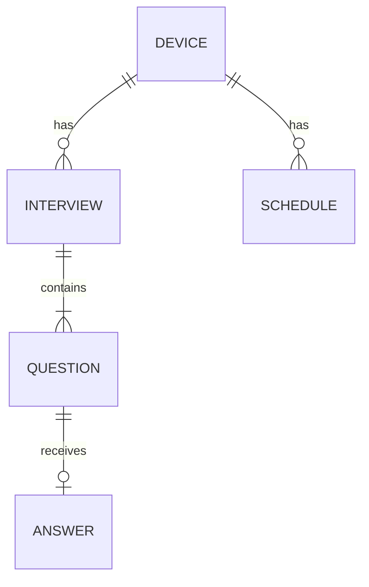

# DATA

## 1. 개요
| 저장소 | 종류 | 접근 방식 | 용도 |
|---|---|---|---|
| Cloudflare D1 | SQLite | Workers D1 바인딩 + 직접 SQL | 면접, 답변, 평가, 일정, AI 스위치 |
| iOS Keychain | 기기 내 보안 저장소 | Security 프레임워크 | 기기 토큰 |

영상과 음성은 어디에도 저장하지 않는다.

## 2. 엔티티 목록
| 엔티티 | 설명 | 저장소 |
|---|---|---|
| device | 익명 사용자(기기) | D1 |
| interview | 모의면접 1회 | D1 |
| question | 면접의 질문 | D1 |
| answer | 질문에 대한 답변, 측정값, 평가 | D1 |
| schedule | 면접 일정 | D1 |
| app_setting | 앱 전체 설정. AI 스위치 포함 | D1 |
| device token | 서버 인증에 쓰는 무작위 값 | Keychain |

## 3. ERD

## 4. 엔티티 상세
시각은 모두 UTC ISO 8601 문자열로 저장하고, 화면에 보여줄 때 기기 시간대로 바꾼다.

### 4.1 device
| 컬럼 | 타입 | 제약 | 설명 |
|---|---|---|---|
| id | TEXT | PK | UUID |
| token_hash | TEXT | NOT NULL, UNIQUE | 기기 토큰의 SHA-256 해시 |
| created_at | TEXT | NOT NULL | 처음 요청한 시각 |
| last_seen_at | TEXT | NOT NULL | 마지막 요청 시각 |

### 4.2 interview
| 컬럼 | 타입 | 제약 | 설명 |
|---|---|---|---|
| id | TEXT | PK | UUID |
| device_id | TEXT | FK, NOT NULL | device.id |
| company_name | TEXT | NULL 허용, 100자 이하 | 회사명 |
| job_title | TEXT | NOT NULL, 1~100자 | 직무 |
| interview_type | TEXT | NOT NULL | `new_grad` / `career_change` |
| question_count | INTEGER | NOT NULL, 1~10 | 질문 수 |
| status | TEXT | NOT NULL | 5절의 상태 |
| started_at | TEXT | NOT NULL | 시작 시각 |
| completed_at | TEXT | NULL 허용 | 평가 완료 시각 |

### 4.3 question
| 컬럼 | 타입 | 제약 | 설명 |
|---|---|---|---|
| id | TEXT | PK | UUID |
| interview_id | TEXT | FK, NOT NULL | interview.id |
| position | INTEGER | NOT NULL, 1부터 | 질문 순서 |
| text | TEXT | NOT NULL | 일본어 질문 |

### 4.4 answer
| 컬럼 | 타입 | 제약 | 설명 |
|---|---|---|---|
| question_id | TEXT | PK, FK | question.id |
| transcript | TEXT | NOT NULL, 10000자 이하 | STT로 받아쓴 답변 |
| duration_ms | INTEGER | NOT NULL, 0 이상 | 답변 시간 |
| gaze_away_ratio | REAL | NULL 허용, 0~1 | 화면에서 시선이 벗어난 시간의 비율 |
| head_movement_deg | REAL | NULL 허용, 0 이상 | 머리 각도 변화의 평균(도) |
| structure_score | INTEGER | NULL 허용, 0~100 | 구성 점수 |
| structure_feedback | TEXT | NULL 허용 | 구성 피드백(일본어) |
| logic_score | INTEGER | NULL 허용, 0~100 | 논리 점수 |
| logic_feedback | TEXT | NULL 허용 | 논리 피드백(일본어) |
| evaluated_at | TEXT | NULL 허용 | 평가 시각 |

### 4.5 schedule
| 컬럼 | 타입 | 제약 | 설명 |
|---|---|---|---|
| id | TEXT | PK | UUID |
| device_id | TEXT | FK, NOT NULL | device.id |
| title | TEXT | NOT NULL, 1~100자 | 일정 이름 |
| starts_at | TEXT | NOT NULL | 시작 시각 |
| ends_at | TEXT | NULL 허용, starts_at 이후 | 종료 시각 |
| location | TEXT | NULL 허용, 200자 이하 | 장소 또는 온라인 주소 |
| memo | TEXT | NULL 허용, 2000자 이하 | 메모 |
| created_at | TEXT | NOT NULL | 생성 시각 |
| updated_at | TEXT | NOT NULL | 수정 시각 |

### 4.6 app_setting
| 컬럼 | 타입 | 제약 | 설명 |
|---|---|---|---|
| key | TEXT | PK | 설정 이름 |
| value | TEXT | NOT NULL | 설정 값 |
| updated_at | TEXT | NOT NULL | 수정 시각 |

## 5. 관계와 제약 조건
- `interview.status`의 전이: `in_progress` → `awaiting_evaluation` → `completed`. 진행 중 그만두면 `in_progress` → `abandoned`. 그 밖의 전이는 허용하지 않는다.
- 삭제는 연쇄 삭제다. device → interview·schedule, interview → question → answer.
- 모든 조회와 변경은 인증된 기기의 데이터로 범위를 제한한다. 다른 기기의 데이터는 존재 여부도 알리지 않고 404를 돌려준다.
- 기기 토큰을 잃으면 서버의 데이터에 다시 접근할 수 없다. 기기를 바꾸거나, Keychain이 지워지거나, 빌드의 서명 팀을 바꾸면 이런 일이 생긴다.
- 답변 원문은 개인정보가 될 수 있다. 서버 관리자는 D1에서 원문을 볼 수 있고, 평가할 때 Claude API로 전송된다. 이 사실을 README와 앱 안에 알린다.

## 6. 마이그레이션
- 도구: Wrangler D1 migrations
- 파일 위치·이름 규칙: `server/migrations/NNNN_설명.sql`
- 적용 명령: `npx wrangler d1 migrations apply <DB 이름> --local` (운영은 `--remote`)
- 롤백 방법: 자동 롤백이 없다. 되돌리는 내용을 새 마이그레이션으로 추가한다.

## 7. 시드·초기 데이터
- 개발용 시드: `server/migrations/`에 넣지 않고 `server/seed/dev.sql`에 둔다.
- 필수 기준 데이터: `app_setting`의 `ai_enabled = '0'`을 첫 마이그레이션에 포함한다.

### 7.1 테스트용 데이터
기능을 만들 때 해당 데이터를 함께 추가하고 위치를 적는다.

| 기법 | 넣어야 할 데이터 | 위치 |
|---|---|---|
| 경계값 | 질문 수 0·1·10·11, 점수 -1·0·100·101, `gaze_away_ratio` -0.1·0·1·1.1 | |
| 문자열 길이 | 빈 문자열, 최소 길이, 최대 길이, 최대 초과 | |
| 특수 문자 | 따옴표, 공백만, 앞뒤 공백, 줄바꿈, 이모지, 한글·일본어, `< > ' " ; --` | |
| 형식 | 잘못된 날짜와 UUID, `ends_at`이 `starts_at`보다 이른 일정 | |
| 수량 | 면접·일정 0건, 1건, 한 페이지를 넘는 다수, 같은 질문에 답변 재전송 | |
| 상태 | 면접의 모든 상태값, 허용되지 않는 상태 전이, AI 스위치 켜짐·꺼짐 | |
| 동등 분할 | 유효·무효 입력 대표 사례, 다른 기기의 데이터 접근, 토큰 없음·잘못된 토큰 | |
