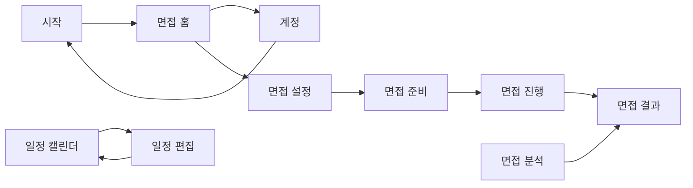

# SITE_MAP

UI 문구는 일본어로 작성한다. 모바일 앱이므로 경로 열에는 탭과 화면 이동 순서를 적는다. 게스트도 모든 기능을 쓸 수 있으므로 모든 화면의 접근은 공개다.

## 1. 화면 목록
| ID | 화면 | 경로 | 접근 | 설명 |
|---|---|---|---|---|
| S-00 | 시작 | 첫 실행, 로그아웃 후 | 공개 | Apple 로그인, 로그인 없이 시작 |
| S-09 | 계정 | 면접 탭 > 시트 | 공개 | 로그인 상태, 게스트의 Apple 로그인, 로그아웃 |
| S-01 | 면접 홈 | 면접 탭 | 공개 | AI 상태 표시, 면접 시작, 최근 기록 |
| S-02 | 면접 설정 | 면접 탭 > 설정 | 공개 | 회사명, 직무, 면접 유형, 질문 수 입력 |
| S-03 | 면접 준비 | 면접 탭 > 설정 > 준비 | 공개 | 카메라·마이크·음성 인식 권한, 얼굴 인식 확인 |
| S-04 | 면접 진행 | 면접 탭 > 설정 > 준비 > 진행 | 공개 | 질문 읽기, 답변 받아쓰기, 시선·머리 측정 |
| S-05 | 면접 결과 | 면접 진행 후, 또는 기록에서 | 공개 | 답변별 구성·논리 평가와 측정값 |
| S-06 | 일정 캘린더 | 일정 탭 | 공개 | 월 달력과 선택한 날짜의 일정 조회 |
| S-07 | 일정 편집 | 일정 탭 > 시트 | 공개 | 일정 추가·수정·삭제 |
| S-08 | 면접 분석 | 분석 탭 | 공개 | 점수와 측정값의 변화 그래프, 면접 기록 목록 |

## 2. 사이트맵 트리
```
시작 (S-00)
└─ 탭 바

탭 바
├─ 면접 (S-01)
│  ├─ 계정 (S-09)
│  ├─ 면접 설정 (S-02)
│  │  └─ 면접 준비 (S-03)
│  │     └─ 면접 진행 (S-04)
│  │        └─ 면접 결과 (S-05)
│  └─ 최근 기록 → 면접 결과 (S-05)
├─ 일정 (S-06)
│  └─ 일정 편집 (S-07)
└─ 분석 (S-08)
   └─ 면접 기록 → 면접 결과 (S-05)
```

## 3. 화면 간 흐름


## 4. 공통 레이아웃·네비게이션
- 레이아웃: 각 탭은 SwiftUI `NavigationStack`을 사용한다.
- 전역 네비게이션: 하단 탭 바
- 모바일 하단 탭 (해당 시): 면접, 일정, 분석. S-03·S-04에서는 집중을 위해 탭 바를 숨긴다.

## 5. 화면별 상세
### 5.0 S-00 시작
- 목적: 로그인 방식을 고른다.
- 구성 요소: 앱 소개, Apple 로그인 버튼, 로그인 없이 시작 버튼, 데이터 저장 안내
- 상태: 로그인 진행 중 / 취소(시작 화면 유지) / 실패(재시도) / Apple 로그인이 꺼진 빌드(버튼 숨김)
- 연결 API·데이터: `POST /v1/auth/apple`

### 5.1 S-01 면접 홈
- 목적: 면접을 시작하거나 지난 결과로 이동한다.
- 구성 요소: AI 사용 가능 여부, 면접 시작 버튼, 최근 기록
- 상태: 로딩 / 기록 없음 / AI 꺼짐(시작 버튼 비활성화, 안내 문구) / 네트워크 오류
- 연결 API·데이터: `GET /v1/status`, `GET /v1/interviews`

### 5.2 S-03 면접 준비
- 목적: 면접 전에 기기와 권한이 준비됐는지 확인한다.
- 구성 요소: 권한 상태, 카메라 미리보기, 얼굴 인식 표시
- 상태: 권한 거부(설정 앱 안내) / 얼굴 추적 미지원 기기(시선·머리 측정 없이 진행) / 준비 완료
- 연결 API·데이터: 없음. 영상은 기기 안에서만 처리한다.

### 5.3 S-04 면접 진행
- 목적: 실제 면접처럼 말로 질문에 답한다.
- 구성 요소: 질문 번호, 질문 문장, 실시간 받아쓰기, 답변 완료 버튼, 중단 버튼
- 상태: 질문 읽는 중 / 답변 대기 / 받아쓰는 중 / 저장 중 / 저장 실패(재시도)
- 연결 API·데이터: `POST /v1/interviews`, `PUT /v1/interviews/:id/questions/:questionId/answer`

### 5.4 S-05 면접 결과
- 목적: 답변별 평가와 개선점을 확인한다.
- 구성 요소: 답변별 구성·논리 점수와 피드백, 받아쓴 답변, 시선·머리 측정값, 삭제 버튼
- 상태: 평가 중 / 평가 대기(AI 꺼짐, 다시 시도 가능) / 평가 실패(다시 시도) / 완료
- 연결 API·데이터: `POST /v1/interviews/:id/evaluation`, `GET /v1/interviews/:id`, `DELETE /v1/interviews/:id`

### 5.5 S-06 일정 캘린더
- 목적: 면접 일정을 달력에서 확인한다.
- 구성 요소: 월 달력, 일정이 있는 날짜 표시, 선택한 날짜의 일정 목록, 추가 버튼
- 상태: 로딩 / 일정 없음 / 네트워크 오류
- 연결 API·데이터: `GET /v1/schedules`

### 5.6 S-08 면접 분석
- 목적: 면접을 반복하며 달라진 점을 그래프로 확인한다.
- 구성 요소: 기간 선택, 구성·논리 점수 추이, 시선·머리 측정값 추이, 면접 기록 목록
- 상태: 로딩 / 데이터 없음 / 완료된 면접 1건(추이 대신 값 표시) / 네트워크 오류
- 연결 API·데이터: `GET /v1/analytics`, `GET /v1/interviews`
