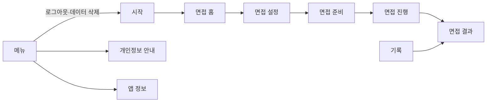

# SITE_MAP

UI 문구는 일본어로 작성한다. 모바일 앱이므로 경로 열에는 탭과 화면 이동 순서를 적는다. 게스트도 모든 기능을 쓸 수 있으므로 모든 화면의 접근은 공개다.

## 1. 화면 목록
S-06·S-07은 일정 관리 기능을 없애면서 비운 번호다.

| ID | 화면 | 경로 | 접근 | 설명 |
|---|---|---|---|---|
| S-00 | 시작 | 첫 실행, 로그아웃·데이터 삭제 후 | 공개 | Apple 로그인, 로그인 없이 시작 |
| S-01 | 면접 홈 | 면접 탭 | 공개 | AI 상태 표시, 면접 시작 |
| S-02 | 면접 설정 | 면접 탭 > 설정 | 공개 | 회사명, 업종, 직무, 면접 유형, 채용 유형 입력 |
| S-03 | 면접 준비 | 면접 탭 > 설정 > 준비 | 공개 | TTS·STT·서버·AI 점검, 카메라 인식 확인, 3초 응시로 기준점 생성 |
| S-04 | 면접 진행 | 면접 탭 > 설정 > 준비 > 진행 | 공개 | 한 질문씩 대화, 답변 받아쓰기, 시선·머리 측정, 일시 정지 |
| S-05 | 면접 결과 | 면접 진행 후, 또는 기록 탭에서 | 공개 | 총점, 항목별 총점, 질문별 점수와 스크립트, 전체 피드백 |
| S-08 | 기록 | 기록 탭 | 공개 | 위쪽에 점수 추이 그래프, 아래쪽에 면접 기록 목록 |
| S-09 | 메뉴 | 메뉴 탭 | 공개 | 질문 수, 계정, 개인정보 안내, 앱 정보, 데이터 전체 삭제 |
| S-10 | 개인정보 안내 | 메뉴 탭 > 개인정보 안내 | 공개 | 어떤 데이터를 어디에 저장·전송하는지 안내 |
| S-11 | 앱 정보 | 메뉴 탭 > 앱 정보 | 공개 | 버전, 공개 저장소 링크 |

## 2. 사이트맵 트리
```
시작 (S-00)
└─ 탭 바

탭 바
├─ 면접 (S-01)
│  └─ 면접 설정 (S-02)
│     └─ 면접 준비 (S-03)
│        └─ 면접 진행 (S-04)
│           └─ 면접 결과 (S-05)
├─ 기록 (S-08)
│  └─ 면접 결과 (S-05)
└─ 메뉴 (S-09)
   ├─ 개인정보 안내 (S-10)
   └─ 앱 정보 (S-11)
```

## 3. 화면 간 흐름


## 4. 공통 레이아웃·네비게이션
- 레이아웃: 각 탭은 SwiftUI `NavigationStack`을 사용한다.
- 전역 네비게이션: 하단 탭 바
- 모바일 하단 탭 (해당 시): 面接(면접), 記録(기록), メニュー(메뉴). S-03·S-04에서는 집중을 위해 탭 바를 숨긴다.

## 5. 화면별 상세
### 5.0 S-00 시작
- 목적: 로그인 방식을 고른다.
- 구성 요소: 앱 소개, Apple 로그인 버튼, 로그인 없이 시작 버튼, 데이터 저장 안내
- 상태: 로그인 진행 중 / 취소(시작 화면 유지) / 실패(재시도) / Apple 로그인이 꺼진 빌드(버튼 숨김)
- 연결 API·데이터: `POST /v1/auth/apple`

### 5.1 S-01 면접 홈
- 목적: 면접을 시작한다.
- 구성 요소: AI 사용 가능 여부, 면접 시작 버튼
- 상태: 로딩 / AI 꺼짐(시작 버튼 비활성화, 안내 문구) / 네트워크 오류
- 연결 API·데이터: `GET /v1/status`

### 5.1.1 S-02 면접 설정
- 목적: 면접 조건을 입력한다. 모든 항목이 필수다.
- 구성 요소:
  - 회사명: 직접 입력
  - 업종: 목록에서 선택, 「その他」를 고르면 직접 입력. 첫 목록은 金融, 福祉, 美容, IT, 医療, 教育, 製造, 小売・サービス, 公務員, その他
  - 직무: 목록에서 선택, 「その他」를 고르면 직접 입력. 첫 목록은 相談員, 教員, システムエンジニア, 美容師, 営業, 事務, 介護職, 看護師, 販売, その他
  - 면접 유형: 人事面接 / 職務面接
  - 채용 유형: 新卒 / 中途
  - 질문 수: 설정 화면의 값을 보여 주기만 한다
- 상태: 입력 중 / 필수 항목 누락(다음 버튼 비활성화)
- 연결 API·데이터: 없음. 입력값은 면접 준비 화면으로 넘긴다.

### 5.2 S-03 면접 준비
- 목적: 면접을 진행할 수 있는지 점검하고, 시선·머리의 기준점을 만든다.
- 필수 점검 (하나라도 실패하면 면접을 시작할 수 없다):
  - TTS: 일본어 음성으로 읽을 수 있는지
  - STT: 마이크·음성 인식 권한이 있고 일본어 인식을 쓸 수 있는지
  - 서버·AI: 서버에 연결되고 AI 스위치가 켜져 있는지 (`GET /v1/status`)
- 시선·머리 측정 준비 (실패해도 면접은 진행한다):
  1. TrueDepth 카메라 지원과 카메라 권한을 확인한다.
  2. 얼굴이 안정적으로 인식되는지 확인한다.
  3. 사용자가 3초간 휴대폰을 응시하면 그때의 시선과 머리 방향을 기준점(중앙)으로 저장한다. 손에 들고 기울어진 자세여도 그 자세가 기준이 된다.
  - 미지원 기기, 카메라 권한 거부, 인식 불안정, 기준점 생성 실패 중 하나면 「視線・頭の動きは評価されません」을 안내하고 측정 없이 진행한다.
- 구성 요소: 점검 항목별 상태, 카메라 미리보기, 얼굴 인식 표시, 3초 응시 안내와 진행 표시, 면접 시작 버튼
- 상태: 점검 중 / 필수 점검 실패(원인 안내, 다시 점검) / 기준점 생성 중 / 측정 없이 진행 / 준비 완료 / 첫 질문 생성 중 / 실패(재시도)
- 연결 API·데이터: `GET /v1/status`, 면접 시작 시 `POST /v1/interviews`(`faceTracking` 포함). 영상은 기기 안에서만 처리한다.

### 5.3 S-04 면접 진행
- 목적: 실제 면접처럼 말로 질문에 답한다.
- 구성 요소: 질문 번호(예: 2/4), 맞장구와 질문 문장, 실시간 받아쓰기, 답변 완료 버튼, 일시 정지 버튼, 그만두기 버튼
- 흐름: 맞장구와 질문을 TTS로 읽음 → 사용자가 답변 → 답변 완료 → 다음 질문 생성 중 → 반복. 마지막 답변 뒤에는 마무리 인사를 읽고 결과 화면으로 간다.
- 일시 정지: 받아쓰기, 측정, 답변 시간을 멈춘다. 서버에는 알리지 않는다. 앱이 백그라운드로 가면 자동으로 일시 정지한다. 앱을 종료한 뒤 다시 열어 이어 하는 기능은 아직 없다(TASK.md의 별도 태스크).
- 그만두기: 확인 창을 띄운 뒤 `DELETE /v1/interviews/:id`로 면접을 지운다.
- 측정: 측정이 켜져 있으면 답변하는 동안 1초마다 시선과 머리가 기준점에서 벗어난 정도를 판정해 단계별로 센다(DATA.md 5.2절). 질문을 읽는 동안은 세지 않는다.
- 오류: TTS·STT·서버·AI에 문제가 생기면 진행을 멈추고 원인을 알린다. 다시 시도하거나 그만둘 수 있다.
- 상태: 질문 읽는 중 / 답변 대기 / 받아쓰는 중 / 다음 질문 생성 중 / 일시 정지 / 오류로 정지(재시도·그만두기)
- 연결 API·데이터: `GET /v1/interviews/:id`(이어 하기), `PUT /v1/interviews/:id/questions/:questionId/answer`, `DELETE /v1/interviews/:id`

### 5.4 S-05 면접 결과
- 목적: 면접 점수와 개선점을 확인한다.
- 구성 요소 (위에서 아래 순서):
  1. 면접 총점 (XX.X점)
  2. 항목별 총점: 답변의 구성, 답변의 논리, 시선의 움직임, 머리의 움직임 (각 XX.X점)
  3. 전체 피드백 문장
  4. 질문마다: 질문 번호, 4개 항목 점수(각 XX.X점), 질문 스크립트, 답변 스크립트
  5. 삭제 버튼
- 시선·머리를 측정하지 않은 면접은 해당 점수 대신 「評価なし」를 표시한다.
- 상태: 평가 중 / 평가 대기(AI 꺼짐, 다시 시도 가능) / 평가 실패(다시 시도) / 완료
- 연결 API·데이터: `POST /v1/interviews/:id/evaluation`, `GET /v1/interviews/:id`, `DELETE /v1/interviews/:id`

### 5.6 S-08 기록
- 목적: 지난 면접을 다시 보고, 반복하며 달라진 점을 그래프로 확인한다.
- 구성 요소:
  1. 위쪽: 기간 선택, 면접 총점 추이, 구성·논리·시선·머리 항목별 총점 추이 그래프
  2. 아래쪽: 끝까지 마친 면접 목록(최신순, 회사명·직무·날짜·총점). 누르면 면접 결과(S-05)로 간다
- 상태: 로딩 / 기록 없음 / 완료된 면접 1건(추이 대신 값 표시) / 네트워크 오류
- 연결 API·데이터: `GET /v1/interviews`. 고른 기간의 기록을 페이지 단위로 모두 받아, 앱이 그래프를 계산해 그린다

### 5.7 S-09 메뉴
- 목적: 앱 설정과 계정, 안내를 한곳에 모은다. 항목은 앞으로 더 늘어날 수 있다.
- 구성 요소:
  - 질문 수 선택(3~7, 기본값 5). 기기에 저장한다
  - 계정: 로그인 상태, Apple 로그인 버튼(게스트일 때), 로그아웃 버튼(Apple 계정일 때)
  - 개인정보 안내(S-10), 앱 정보(S-11)로 가는 항목
  - 데이터 전체 삭제: 확인 창을 띄운 뒤 삭제하고 시작 화면(S-00)으로 간다
- 상태: 기본 / 로그인 진행 중 / 삭제 중 / 실패(재시도)
- 연결 API·데이터: `GET /v1/me`, `POST /v1/auth/apple`, `POST /v1/auth/logout`, `DELETE /v1/me`

### 5.8 S-10 개인정보 안내
- 목적: 어떤 데이터가 어디에 저장·전송되는지 알린다.
- 내용: 영상·음성은 저장·전송하지 않음, 받아쓴 답변과 감점 횟수는 서버에 저장되고 운영자가 볼 수 있음, 답변은 평가와 질문 생성을 위해 Claude API로 전송됨, Apple 이메일·이름은 저장하지 않음, 메뉴에서 데이터를 모두 삭제할 수 있음
- 연결 API·데이터: 없음

### 5.9 S-11 앱 정보
- 구성 요소: 앱 이름, 버전, 공개 저장소 링크
- 연결 API·데이터: 없음
