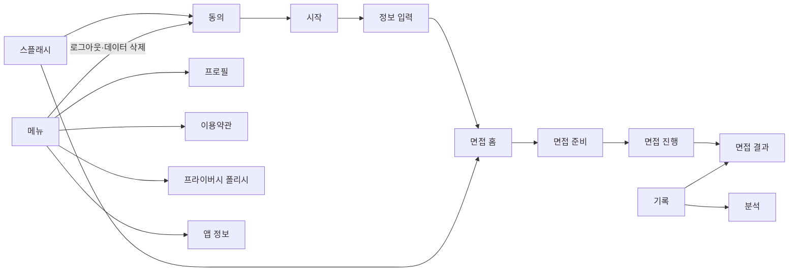

# SITE_MAP

UI 문구는 일본어로 작성한다. 모바일 앱이므로 경로 열에는 탭과 화면 이동 순서를 적는다. 게스트도 모든 기능을 쓸 수 있으므로 모든 화면의 접근은 공개다.

## 1. 화면 목록
S-06·S-07은 일정 관리 기능을 없애면서, S-02(면접 설정)는 면접 홈(S-01)에 합치면서 비운 번호다.

| ID | 화면 | 경로 | 접근 | 설명 |
|---|---|---|---|---|
| S-13 | 스플래시 | 앱을 새로 켤 때 | 공개 | 로고 애니메이션, 앱 시작 준비(서버 연결·끝나지 않은 면접 정리) |
| S-14 | 동의 | 첫 실행, 로그아웃·데이터 삭제 후 | 공개 | 이용약관·개인정보 처리방침 동의 (온보딩 ①) |
| S-00 | 시작 | 동의 다음 | 공개 | Apple 로그인, 로그인 없이 시작 |
| S-15 | 정보 입력 | 시작 다음 | 공개 | 이름(닉네임, 필수), 채용 유형·업계·직종(선택) 입력 (온보딩 ②) |
| S-01 | 면접 홈 | 면접 탭 | 공개 | AI 상태 표시, 회사명·업계·직종·면접 유형·채용 유형 입력, 면접 시작 |
| S-03 | 면접 준비 | 면접 탭 > 준비 | 공개 | TTS·STT·서버·AI 점검, 카메라 인식 확인, 3초 응시로 기준점 생성 |
| S-04 | 면접 진행 | 면접 탭 > 준비 > 진행 | 공개 | 한 질문씩 대화, 답변 받아쓰기, 시선·머리 측정, 일시 정지 |
| S-05 | 면접 결과 | 면접 진행 후, 또는 기록 탭에서 | 공개 | 총점, 항목별 총점, 질문별 점수와 스크립트, 전체 피드백 |
| S-08 | 기록 | 기록 탭 | 공개 | 위쪽에 점수 요약과 작은 추이 그래프, 아래쪽에 면접 기록 목록 |
| S-09 | 메뉴 | 메뉴 탭 | 공개 | 프로필, 계정, 이용약관, 프라이버시 폴리시, 앱 정보, 데이터 전체 삭제 |
| S-10 | 프라이버시 폴리시 | 메뉴 탭 > プライバシーポリシー, 동의·시작 화면의 링크 | 공개 | 어떤 데이터를 어디에 저장·전송하는지 안내 (개인정보 처리방침) |
| S-16 | 이용약관 | 메뉴 탭 > 利用規約, 동의 화면의 링크 | 공개 | 앱 이용 조건 |
| S-17 | 프로필 | 메뉴 탭 > プロフィール | 공개 | 온보딩에서 입력한 이름(닉네임)·희망 조건 수정 |
| S-11 | 앱 정보 | 메뉴 탭 > 앱 정보 | 공개 | 버전, 공개 저장소 링크 |
| S-12 | 분석 | 기록 탭 > 요약 카드 | 공개 | 기간별 점수 추이, 강점·약점, 면접 종류·채용 구분별 비교 |

## 2. 사이트맵 트리
```
스플래시 (S-13)
├─ 동의 (S-14, 처음 실행)
└─ 탭 바 (온보딩을 마친 뒤)

동의 (S-14)
└─ 시작 (S-00)
   └─ 정보 입력 (S-15)
      └─ 탭 바

탭 바
├─ 면접 (S-01)
│  └─ 면접 준비 (S-03)
│     └─ 면접 진행 (S-04)
│        └─ 면접 결과 (S-05)
├─ 기록 (S-08)
│  ├─ 분석 (S-12)
│  └─ 면접 결과 (S-05)
└─ 메뉴 (S-09)
   ├─ 프로필 (S-17)
   ├─ 이용약관 (S-16)
   ├─ 프라이버시 폴리시 (S-10)
   └─ 앱 정보 (S-11)
```

## 3. 화면 간 흐름


## 4. 공통 레이아웃·네비게이션
- 레이아웃: 각 탭은 SwiftUI `NavigationStack`을 사용한다.
- 전역 네비게이션: 하단 탭 바
- 모바일 하단 탭 (해당 시): 面接(면접), 記録(기록), メニュー(메뉴). S-03·S-04에서는 집중을 위해 탭 바를 숨긴다.
- 업계·직종 선택: 앱 어디서나 펼침 메뉴가 아니라 새 화면에서 고른다. 정보 입력(S-15)·프로필(S-17)·면접 홈(S-01)이 같은 화면을 쓴다.
  - 목록: 대분류와 소분류 두 단계(`Domain/ChoiceCatalog.swift`, 초안이며 TASK.md에서 다시 검토). 저장·전송하는 값은 소분류 이름이다
  - 디자인: 온보딩과 같은 바탕(도트 무늬). 대분류 줄은 「01」 같은 번호(고정폭, 포인트 색), 이름, 소분류 개수, 펼침 화살표. 줄 사이는 포인트 색의 옅은 선. 고른 줄은 포인트 색 글자, 왼쪽에 빛나는 세로 막대, 오른쪽 체크. 뒤로 가기 버튼은 포인트 색(기본 버튼은 색을 바꿀 수 없어 직접 그리며, 왼쪽 끝에서 오른쪽으로 밀어도 돌아간다)
  - 펼치기: 처음에는 대분류만 보이고 누르면 소분류가 펼쳐진다. 이미 고른 값이 있으면 그 대분류를 펼쳐 둔다
  - 검색: 위쪽 검색 칸. 대분류 이름이 맞으면 그 소분류를 모두, 아니면 이름이 맞는 소분류만 펼쳐 보여 준다. 히라가나·가타카나, 전각·반각, 대소문자는 구분하지 않는다. 맞는 것이 없으면 「その他」로 입력하라고 안내한다
  - 고르기: 소분류를 고르면 바로 앞 화면으로 돌아간다. 「選択しない」는 정보 입력에서만 보인다
  - 「その他」: 목록 맨 아래. 누르면 목록이 위로 접히고 입력 칸(50자까지)이 나타나 바로 입력한다. 「リストから選ぶ」를 누르면 목록이 다시 펼쳐진다. 원래 화면에는 입력한 값을 보여 준다

## 5. 화면별 상세
### 5.0.1 S-13 스플래시
- 목적: 앱을 켤 때 로고를 보여 주며 앱을 시작할 준비를 한다.
- 언제 보이는지: 앱을 새로 켤 때만. 백그라운드에서 돌아올 때나 로그아웃·데이터 삭제 뒤에는 보이지 않는다.
- 실행 화면: iOS가 앱을 여는 순간에는 파란색 한 가지 색(`LaunchBackground`, #176DDC)을 보여 주고, 스플래시가 뜨면 0.25초 동안 그라데이션으로 바꾼다.
- 디자인: 밝은/어두운 모드와 관계없이 앱 아이콘과 같은 파란 그라데이션(#2392FF → #176DDC → #0745B6). 가운데에 아이콘의 흰 그림(사람·책상, 가로 160pt), 그 아래 앱 이름 「就活一歩」.
- 애니메이션 (앱이 열린 뒤 초):
  - 0 ~ 0.75: 머리·몸·책상·다리를 빛나는 흰 선으로 그린다
  - 0.6 ~ 0.95: 선 안을 흰색으로 채운다
  - 0.85 ~ 2.15: 투명하고 아주 연한 빛의 띠(두께 145pt, 수평에서 60° 기울어짐)가 왼쪽 아래에서 오른쪽 위로 1.3초 동안 ease-out으로 지나간다. 처음에는 그라데이션만 있고, 띠가 지나간 자리에 도트가 반짝이며 생긴다. 도트는 아이콘처럼 오른쪽 위로 갈수록 크고 밝다
  - 1.0 ~ 1.5: 앱 이름을 커서와 함께 한 글자씩 보여 준다
  - 기기의 '동작 줄이기'가 켜져 있으면 완성된 모습이 0.4초 동안 나타난다
- 준비 (동시에 진행):
  1. 서버 연결과 AI 상태 확인(`GET /v1/status`). 안내 「サーバーに接続しています…」
  2. 온보딩을 마친 뒤라면 끝나지 않은 면접 정리(ARCHITECTURE.md 6절). 안내 「前回の面接を確認しています…」
  - 실패해도 준비가 끝난 것으로 본다. 연결 문제는 다음 화면이 안내한다
  - 평가 대기 면접의 자동 평가는 오래 걸릴 수 있어 기다리지 않고, 탭 화면이 열릴 때 한다
- 넘어가기: 애니메이션이 끝나고 완성된 로고를 0.3초 보여 준 뒤(약 2.45초) 준비가 끝났으면 스플래시가 살짝 커지며(1.12배) 0.45초 동안 사라진다. 준비가 덜 끝났으면 이름 바로 아래에 작은 안내 문구, 화면 아래 가운데에 가는 진행 막대(빛이 좌우로 오감)를 보여 주고, 준비가 끝나면 바로, 3초가 지나도 안 끝나면 일단 넘어간다. 사라지는 동안에도 마지막 안내 문구를 그대로 둔다. 먼저 넘어가도 준비는 끝까지 진행한다
- 다음 화면: 온보딩을 마쳤으면 면접 홈(S-01), 아니면 동의(S-14)
- 확인용(개발 빌드만): 실행 인자 `-splashLoop YES`면 끝나고 1초 뒤 다시 보여 주고, `-splashDelay 초`면 준비를 일부러 늦춘다(OPERATIONS.md 3절)
- 연결 API·데이터: `GET /v1/status`, `GET /v1/interviews/:id`, `DELETE /v1/interviews/:id`

### 5.0 S-00 시작
- 목적: 앱을 소개하고 로그인 방식을 고른다.
- 언제 보이는지: 온보딩(동의 → 시작 → 정보 입력)의 가운데 화면이다. 온보딩을 마쳤는지를 기기에 저장해 두고, 첫 실행과 로그아웃·데이터 삭제 후에만 온보딩을 보여 준다. 그 밖에는 바로 탭 바로 간다. 로그인 없이 시작하면 기기 토큰이 그대로라 기록도 그대로다
- 다음 화면: Apple 로그인에 성공하거나 「ログインなしで始める」를 누르면 정보 입력(S-15)
- 구성 요소 (위에서 아래 순서):
  1. 앱 소개: 앱 로고(앱 아이콘과 같은 그림), 앱 이름(就活一歩), 한 줄 설명, 특징 3줄을 담은 카드
  2. Apple 로그인 버튼(메뉴와 같은 버튼, 이메일·이름 요청 없음)
  3. 「ログインなしで始める」 버튼
  4. 「プライバシーポリシー」 링크: 프라이버시 폴리시(S-10)를 아래에서 올라오는 창으로 연다
- 디자인: 화면 바탕은 밝은 모드에서 흰색→연한 파랑, 어두운 모드에서 다른 화면처럼 검은색에 가까운 색(#0A0E17→#000000). 도트 무늬, 파랑 포인트. 특징 카드와 「ログインなしで始める」 버튼은 온보딩(S-14·S-15)과 같다: 테두리 없는 남색 카드, 파랑 그라데이션에 흰 글자인 버튼. Apple 로그인 버튼은 이 버튼과 높이(50pt)를 맞춘다
- 상태: 로그인 진행 중(화면 잠금) / 취소(알리지 않고 시작 화면 유지) / 실패(알림 창, 버튼을 다시 눌러 재시도) / Apple 로그인이 꺼진 빌드(Apple 버튼만 숨김)
- 연결 API·데이터: `POST /v1/auth/apple`. 로그인 없이 시작은 서버를 부르지 않는다

### 5.0.2 S-14 동의 (온보딩 ①)
- 목적: 앱을 쓰기 전에 이용약관과 개인정보 처리방침에 동의를 받는다.
- 언제 보이는지: 지금 버전의 약관에 동의하지 않았을 때다. 처음 실행, 로그아웃·데이터 삭제 뒤, 온보딩 전부터 쓰던 사용자, 약관 버전(`LegalDocument.version`)이 바뀐 사용자
  - 약관 버전만 바뀐 사용자(이미 시작했고 이 iPhone에 프로필이 있음): 이 화면 대신 스플래시가 끝난 뒤 탭 화면 위에 같은 내용의 모달(화면 높이의 56%)을 띄운다. 버튼 문구는 「すべてに同意する」다. 제목 「規約の更新」, 안내 「利用規約とプライバシーポリシーを更新しました。内容をご確認のうえ、同意をお願いします。」, 단계 표시 없음. 아래로 밀어 닫을 수 없고, 버튼을 누르면 그 자리에서 동의 기록을 서버에 남긴 뒤 닫힌다. 실패하면 알림 창 「保存できませんでした」를 띄우고 모달에 남는다(다시 누를 수 있다)
  - 온보딩 전부터 쓰던 사용자(이미 시작했지만 이 iPhone에 프로필이 없음): 동의 → 정보 입력(S-15)을 한 번 거친다. 시작 화면은 건너뛴다
- 디자인: 시작 화면과 같은 바탕(어두운 모드에서는 검은색에 가까운 색)과 남색 카드. 위쪽에 앱 아이콘·이름과 단계 표시 「1 / 2」, 제목 「ご利用の前に」와 안내 문장, 아래쪽에 고정된 버튼. 버튼은 밝은/어두운 모드 모두 앱 아이콘과 같은 파랑 그라데이션(왼쪽 위 #2392FF → 오른쪽 아래 #176DDC)에 흰 글자이며 정보 입력 화면도 같다
- 구성 요소:
  1. 테두리 없는 카드 안에 「利用規約」「プライバシーポリシー」 두 줄(카드 위아래 여백 14.4pt, 줄 간격 12.8pt). 줄마다 체크 버튼, 한 줄 설명, 본문을 아래에서 올라오는 창으로 여는 오른쪽 화살표(굵지 않은 쉐브론만, 글자 없음)
  2. 「すべてに同意して次へ」: 늘 누를 수 있다. 누르면 두 항목이 모두 체크되고 0.2초 뒤에 다음 화면으로 넘어간다. 넘어가는 동안 다시 눌러도 한 번만 처리한다
- 저장: 동의한 문서별 버전(날짜)을 기기에 저장한다. 서버에는 정보 입력(S-15)을 마칠 때 함께 보낸다
- 본문: 앱 안에 넣는다. 이용약관(S-16)과 프라이버시 폴리시(S-10) 화면을 그대로 연다
- 다음 화면: 시작(S-00)
- 연결 API·데이터: 없음(서버 저장은 S-15에서)

### 5.0.3 S-15 정보 입력 (온보딩 ②)
- 목적: 화면과 AI 면접관이 부를 닉네임, 면접 홈의 입력을 미리 채울 희망 조건을 받는다.
- 이어 하기: 시작 화면에서 로그인 방식을 고른 것을 기기에 저장한다. 정보 입력 도중 앱이 꺼지면 다음 실행 때 이 화면부터 다시 보여 준다
- 디자인: 동의 화면과 같은 틀. 단계 표시 「2 / 2」, 제목 「あなたについて教えてください」, 안내 문장은 두 줄 「お名前（ニックネーム）だけで始められます。」「ほかの項目は後からメニューで変更できます。」
- 구성 요소 (카드 안, 위에서 아래 순서):
  1. お名前（ニックネーム）(必須): 앞뒤 공백을 지우고 1~20자. 넘으면 빨간 안내 「20文字以内で入力してください」
  2. 採用区分(任意): 新卒(학사모 아이콘) / 中途(서류 가방 아이콘) 버튼. 아이콘은 글자보다 작고 가는 선이다. 다시 누르면 선택을 지운다
  3. 業界·職種(任意): 줄을 누르면 업계·직종 선택 화면으로 넘어간다(4절). 원래 화면에는 고른 소분류(その他면 입력한 값)를 보여 준다
  4. 「はじめる」: 닉네임이 있고 모든 항목이 글자 수 안이면 누를 수 있다
- 미리 채우기: 화면이 열리면 서버의 프로필을 불러와 채운다(같은 Apple 계정으로 다른 iPhone에서 입력한 값). 서버에 없거나 받지 못하면 이 iPhone에 남은 값으로 채운다
- 저장: 「はじめる」를 누르면 동의 기록(`POST /v1/me/consents`)을 남긴 뒤 프로필(`PUT /v1/me/profile`)을 저장하고, 이 iPhone에도 같은 값을 둔다. 저장하는 동안 화면을 잠그고, 실패하면 알림 창 「保存できませんでした」를 띄우고 이 화면에 남는다
- 이름(닉네임)은 AI 면접관이 질문·피드백에서 「〇〇さん」으로 부를 때 쓴다. 희망 조건은 면접 홈(S-01)의 입력을 미리 채운다
- 다음 화면: 면접 홈(S-01). 저장에 성공하면 온보딩을 마친 것으로 저장한다
- 연결 API·데이터: `GET /v1/me/profile`, `POST /v1/me/consents`, `PUT /v1/me/profile`

### 5.1 S-01 면접 홈
- 목적: 면접 조건을 입력하고 바로 면접을 시작한다. 따로 있던 면접 설정 화면(옛 S-02)을 이 화면에 합쳤다(2026-11-08).
- 구성 요소 (위에서 아래 순서):
  1. 상태 카드: 왼쪽에 빛나는 점(사용 가능은 초록, AI 꺼짐은 회색, 연결 실패는 빨강), 오른쪽에 상태 문구
     - 사용 가능: 「AI面接官の準備ができています」와 지금 고른 조건 요약(「人事面接・新卒・5問」)
     - AI 꺼짐: 「現在、AI機能は停止中です」와 「過去の記録は「記録」タブで見られます」
     - 연결 실패: 「サーバーに接続できませんでした」와 「再試行」 버튼
     - 확인 중(처음 열 때와 再試行): 「AIの状態を確認しています」
  2. 「01 応募先」 카드: 한 줄에 이름과 값을 나란히 둔다
     - 会社名: 직접 입력(100자까지). 비워 두면 「株式会社就活一歩」로 면접한다. 입력 칸에 이 이름을 회색으로 보여 준다
     - 業界·職種: 누르면 새 화면의 대분류·소분류 목록이 열린다(4절). 반드시 골라야 하므로 「選択しない」는 없다. 고르지 않았으면 「選択してください」
  3. 「02 面接の条件」: 면접 유형(人事面接 / 職務面接)과 채용 유형(新卒 / 中途, 학사모·가방 아이콘) 버튼, 질문 수(3~7, 기본값 5)를 −/+ 버튼으로 고른다. 마지막으로 고른 값을 기기에 저장해 다음에도 그 값으로 시작한다(질문 수는 이 화면에서만 바꾼다)
  4. 아래에 고정된 「面接を始める」 버튼: 면접 준비(S-03)로 간다
- 미리 채우기: 처음에는 이 iPhone에 둔 프로필(S-15·S-17)의 채용 유형·업계·직종으로 채운다. 목록에 없는 값은 「その他」에 직접 입력한 값으로 채운다. 이 화면에서 바꾼 값은 프로필에 저장하지 않는다
- 다시 보일 때(탭을 오가거나 면접을 마치고 돌아왔을 때): 입력값을 그대로 남겨 같은 조건으로 다시 연습할 수 있게 한다. 다만 메뉴에서 프로필을 바꿨으면 채용 유형·업계·직종을 새 프로필 값으로 다시 채운다(회사명·면접 유형·질문 수는 그대로, `Domain/InterviewForm.swift`)
- 상태: 확인 중 / 사용 가능 / AI 꺼짐(시작 버튼 비활성화) / 연결 실패(시작 버튼 비활성화) / 업계·직종을 고르지 않음(시작 버튼 비활성화). 탭을 오가거나 아래로 당기면 AI 상태를 다시 확인한다
- 디자인: 온보딩과 같은 바탕(어두운 모드는 검은색에 가까운 색, 도트 무늬), 남색 카드, 파랑 그라데이션에 흰 글자인 버튼. 제목은 큰 글씨 「面接」. 묶음 이름 앞에 「01」 같은 번호(고정폭, 포인트 색)
- 연결 API·데이터: `GET /v1/status`. 입력값은 면접 준비 화면으로 넘긴다.

### 5.2 S-03 면접 준비
- 목적: 면접을 진행할 수 있는지 점검하고, 시선·머리의 기준점을 만든다.
- 필수 점검 (하나라도 실패하면 면접을 시작할 수 없다):
  - TTS: 일본어 음성으로 읽을 수 있는지
  - STT: 마이크·음성 인식 권한이 있고 일본어 인식을 쓸 수 있는지
  - 서버·AI: 서버에 연결되고 AI 스위치가 켜져 있는지 (`GET /v1/status`)
- 시선·머리 측정 준비 (실패해도 면접은 진행한다):
  1. TrueDepth 카메라 지원과 카메라 권한을 확인한다.
  2. 얼굴이 안정적으로 인식되는지 확인한다.
  3. 사용자가 3초간 휴대폰을 응시하면 그때의 시선과 머리 방향을 기준점(중앙)으로 저장한다. 손에 들고 기울어진 자세여도 그 자세가 기준이 된다.
  - 미지원 기기, 카메라 권한 거부, 인식 불안정, 기준점 생성 실패 중 하나면 「視線・頭の動きは評価されません」을 안내하고 측정 없이 진행한다.
  - 기준점은 설정한 뒤에도 「やり直す」로 다시 잡을 수 있다. 인식이 불안정해 건너뛴 경우도 다시 잡을 수 있다.
- 화면 배치 (시안 A, 2026-11-08): 사용자가 자기 모습을 볼 수 있게 늘 카메라 자리를 화면 전체에 깔고, 점검 결과·기준점·시작 버튼은 아래쪽 반투명 카드에 둔다. 제목과 뒤로 가기는 카메라 위라 밝은/어두운 모드 모두 흰색이다.
- 카메라 자리 (`Domain/PreparationCamera.swift`):
  - Face ID 카메라가 있는 iPhone: 얼굴 인식 영상(아래 인식 확인 표시)과 위쪽 시선·머리 과녁
  - Face ID 카메라가 없는 iPhone: 앞쪽 카메라 영상을 거울처럼 보여 주기만 한다. 시선·머리는 재지 않는다
  - 카메라를 허용하지 않음: 「カメラが許可されていません」, 「自分の姿を確認するには、設定でカメラを許可してください。カメラなしでも面接はできます。」, 「設定を開く」 버튼(iOS 설정 앱의 이 앱 화면을 연다)
  - 카메라가 없는 기기(시뮬레이터 등): 「カメラを利用できません」, 「カメラなしでも面接はできます。」
  - 영상이 없을 때는 어두운 바탕을 깐다. 어느 경우든 영상은 화면에만 보여 주고 저장하거나 보내지 않는다
  - 면접을 시작하면 카메라를 끄지 않고 면접 진행 화면(S-04)의 작은 내 화면으로 넘긴다. 이때 준비 화면은 화면 경로에서 빼서 같은 영상을 두 화면이 함께 그리지 않게 한다
- 아래 카드 (위에서 아래 순서):
  1. 점검 칩 3개 「読み上げ」 「聞き取り」 「AI接続」: 확인 중(돌아가는 표시), 통과(초록 체크), 실패(빨간 X)
  2. 실패한 점검이 있으면 원인 문구(빨강)와 「もう一度確認する」 버튼. 누르면 필수 점검만 다시 한다
  3. 기준점 줄: 상태 문구와 「設定する」(처음) 또는 「やり直す」 버튼
  4. Face ID 카메라를 쓸 때만 「スマートフォンを手に持って面接を受ける場合も、その姿勢のまま基準点を設定してください。」
  5. 시작 오류 문구, 그라데이션 「面接を始める」 버튼
- 점검 뒤에 AI가 꺼져 시작이 거절되면 「AI接続」 칩도 실패로 바꿔 다시 점검할 수 있게 한다.
- 인식 확인 표시 (각도 기준 조정용):
  - 카메라 영상 위에 ARKit이 인식한 얼굴 그물망을 선으로 겹쳐 그리고, 눈·코끝·입 중앙에 점을 찍는다.
  - 양쪽 눈에서 보고 있는 방향으로 선을 그린다.
  - 화면 위쪽에 시선·머리 과녁을 둔다. 원은 감점 기준 각도(DATA.md 5.2절), 점은 기준점에서 벗어난 방향, 숫자는 벗어난 각도(도)와 단계다. 기준점을 잡기 전에는 정면(0도) 기준으로 보여 준다.
  - 영상은 화면에만 보여 주고 저장하거나 보내지 않는다.
- 구성 요소: 점검 항목별 상태, 카메라 미리보기, 얼굴 인식 표시, 3초 응시 안내와 진행 표시, 면접 시작 버튼
- 상태: 점검 중 / 필수 점검 실패(원인 안내, 다시 점검) / 기준점 생성 중 / 측정 없이 진행 / 준비 완료 / 첫 질문 생성 중 / 실패(재시도)
- 연결 API·데이터: `GET /v1/status`, 면접 시작 시 `POST /v1/interviews`(`faceTracking` 포함). 영상은 기기 안에서만 처리한다.

### 5.3 S-04 면접 진행
- 목적: 실제 면접처럼 말로 질문에 답한다.
- 화면 배치 (시안 B, 2026-11-08): 온보딩과 같은 바탕(도트 무늬). 위에서 아래 순서로 다음을 둔다.
  1. 맨 위: 빨간 「やめる」, 제목 「面接」
  2. 진행 표시: 「質問 1 / 5」와 질문 수만큼 나눈 막대. 지난 질문과 지금 질문 칸을 포인트 색으로 채운다
  3. 면접관: 파란 그라데이션 원과 사람 아이콘, 「面接官」. 질문과 마무리 인사를 읽는 동안 둘레에 고리가 천천히 퍼진다. '동작 줄이기'가 켜져 있으면 멈춘 고리를 보여 준다
  4. 작은 내 화면(오른쪽 위): 준비 화면에서 켠 카메라 영상만 보여 준다(얼굴 인식 표시 없음). Face ID iPhone은 얼굴 인식 카메라, Face ID가 없는 iPhone은 거울 화면이다. 기준점이 없어 측정하지 않아도 보여 주고, 카메라를 허용하지 않았거나 카메라가 없으면 숨긴다. 영상은 저장하거나 보내지 않는다
  5. 질문 카드: 맞장구(회색)와 질문(굵게)
  6. 답변 카드: 단계 표시와 내용. 읽는 중 「読み上げ中」과 「読み上げが終わると、回答の聞き取りを始めます」, 듣는 중 「お話しください」와 목소리 막대와 받아쓴 글(비어 있으면 「（聞き取った内容がここに表示されます）」), 다음 질문 준비 중, 일시 정지 「一時停止中」과 받아쓴 글, 오류 문구. 받아쓴 글이 길어지면 남은 자리를 차지하고, 넘치면 카드 안에서 스크롤하며 늘 마지막 줄을 보여 준다
  7. 버튼: 읽는 중 「一時停止」(테두리 버튼), 듣는 중 「一時停止」와 그라데이션 「回答を終える」, 일시 정지 중 「再開する」, 오류 때 「再試行」
- 목소리 막대: 마이크 소리 크기에 맞춰 움직인다. 크기는 기기 안에서만 계산하고 저장하거나 보내지 않는다(`Domain/AudioLevel.swift`)
- 구성 요소: 질문 번호(예: 2/4), 맞장구와 질문 문장, 실시간 받아쓰기, 답변 완료 버튼, 일시 정지 버튼, 그만두기 버튼
- 흐름: 맞장구와 질문을 TTS로 읽음 → 사용자가 답변 → 답변 완료 → 다음 질문 생성 중 → 반복. 마지막 답변 뒤에는 마무리 인사를 읽고 결과 화면으로 간다.
- 일시 정지: 받아쓰기, 측정, 답변 시간을 멈춘다. 서버에는 알리지 않는다. 앱이 백그라운드로 가면 자동으로 일시 정지한다. 앱을 종료한 면접은 이어 할 수 없고, 다시 열면 이 iPhone에서 시작했다가 끝나지 않은 면접을 확인 없이 지운다. 마지막 답변 뒤에 앱이 꺼져 평가 대기로 남은 면접은 다시 열 때 AI가 켜져 있으면 자동으로 평가한다(ARCHITECTURE.md 6절).
- 그만두기: 일시 정지한 뒤 화면 가운데에 「面接をやめますか？」, 「途中でやめた面接は保存されません。」와 「続ける」·「やめる」 버튼이 있는 창을 띄운다. 「やめる」를 누르면 `DELETE /v1/interviews/:id`로 면접을 지운다.
- 측정: 측정이 켜져 있으면 답변하는 동안 1초마다 시선과 머리가 기준점에서 벗어난 정도를 판정해 단계별로 센다(DATA.md 5.2절). 질문을 읽는 동안은 세지 않는다.
- 오류: TTS·STT·서버·AI에 문제가 생기면 진행을 멈추고 원인을 알린다. 다시 시도하거나 그만둘 수 있다.
- 상태: 질문 읽는 중 / 답변 대기 / 받아쓰는 중 / 다음 질문 생성 중 / 일시 정지 / 오류로 정지(재시도·그만두기)
- 연결 API·데이터: `PUT /v1/interviews/:id/questions/:questionId/answer`, `DELETE /v1/interviews/:id`

### 5.4 S-05 면접 결과
- 목적: 면접 점수와 개선점을 확인한다.
- 화면 배치 (시안 B, 2026-11-08): 온보딩과 같은 바탕(도트 무늬). 위에서 아래 순서로 다음을 둔다.
  1. 총점 카드: 「総合点」, 면접 총점(XX.X점, 큰 포인트 색 숫자), 「회사명・직종・면접 종류・날짜」, 항목별 총점(답변의 구성, 답변의 논리, 시선의 움직임, 머리의 움직임)의 거미줄 차트, 「強み」·「弱み」 칸. 가장 높은 항목은 초록, 가장 낮은 항목은 빨강이며, 점수가 모두 같으면 강점·약점 칸을 숨긴다(분석 화면과 같은 규칙)
  2. 「01 フィードバック」: 전체 피드백 문장
  3. 「02 質問ごとの結果」: 「Q1」부터 질문 수만큼 버튼을 두고(처음에는 Q1), 고른 질문의 4개 항목 점수(각 XX.X점), 맞장구와 질문 스크립트, 답변 스크립트(없으면 「（回答なし）」)를 보여 준다
  4. 「この記録を削除」(빨간 테두리 버튼). 누르면 화면 가운데에 「この面接の記録を削除しますか？」, 「削除した記録は元に戻せません。」와 「キャンセル」·「削除」 버튼이 있는 창을 띄운다
- 시선·머리를 측정하지 않은 면접은 해당 점수 대신 「評価なし」를 표시한다. 거미줄 차트는 항목이 3개 이상이어야 모양이 되므로, 이때는 구성·논리 가로 막대 2개와 「この面接では視線・頭の動きを測定していません」를 보여 준다.
- 채점 중: 면접 진행 화면과 같은 면접관 아이콘에 고리가 퍼지고 「採点しています…」를 보여 준다.
- 오류: 경고 아이콘, 원인 문구, 그라데이션 「再試行」 버튼.
- 상태: 평가 중 / 평가 대기(AI 꺼짐, 다시 시도 가능) / 평가 실패(다시 시도) / 완료
- 연결 API·데이터: `POST /v1/interviews/:id/evaluation`, `GET /v1/interviews/:id`, `DELETE /v1/interviews/:id`

### 5.6 S-08 기록
- 목적: 지난 면접을 다시 보고, 최근 점수를 한눈에 확인한다.
- 화면 배치 (시안 A, 2026-11-08): 큰 제목 「記録」, 온보딩과 같은 바탕(도트 무늬). 위에서 아래 순서로 다음을 둔다.
  1. 요약 카드: 가장 최근 면접의 총점(둥근 게이지), 「最新の総合点」, 「前回比」(바로 전 면접과의 총점 차이, 오르면 초록·내리면 빨강), 최근 10회 총점의 작은 추이 그래프(빛나는 선과 색 면), 아래에 「分析を見る」 버튼 줄. 카드 어디를 눌러도 분석(S-12)으로 간다
  2. 「01 過去の面接」: 평가가 끝난 면접을 달별(「2026年11月」, 기기의 지역 시간 기준)로 묶은 카드. 최신 달이 위에 오고, 줄마다 회사명, 면접 종류·채용 구분 칩, 「직무・날짜」, 총점. 누르면 면접 결과(S-05)로 간다. 결과 화면에서 삭제하면 목록으로 돌아와 다시 불러온다
- 상태: 로딩 / 기록 없음(「まだ記録がありません」, 안내, 그라데이션 「面接を始める」를 누르면 면접 탭으로 옮김) / 완료된 면접 1건(前回比 없이 점수와 점 하나짜리 추이 그래프) / 네트워크 오류(「サーバーに接続できませんでした。」, 그라데이션 「再試行」. 이미 받은 기록이 있으면 그대로 보여 준다)
- 탭을 열 때와 아래로 당길 때 다시 불러온다(기록 없음 화면에서도).
- 연결 API·데이터: `GET /v1/interviews`. 모든 페이지를 받아 평가가 끝난(`completed`) 면접만 쓴다. 요약·목록·분석은 같은 데이터로 앱이 계산한다

### 5.6.1 S-12 분석
- 목적: 반복하며 달라진 점과 강점·약점을 여러 관점으로 확인한다.
- 화면 배치 (시안 B, 2026-11-08): 온보딩과 같은 바탕(도트 무늬). 위에서 아래 순서로 다음을 둔다.
  1. 기간 버튼: 1か月 / 3か月(기본) / 全期間(파란 그라데이션으로 고른 값 표시). 아래 모든 항목에 적용한다
  2. 숫자 칸 4개(항상 총점 기준): 「期間平均」, 「面接回数」, 「最高点」(그 면접의 날짜), 「伸び」(기간 안의 첫 면접과 최근 면접의 총점 차이, 오르면 초록·내리면 빨강, 면접이 1번뿐이면 「—」)
  3. 탭 「推移 / 強み・弱み / 種類別」: 고른 탭의 카드 하나만 보여 준다(처음에는 推移)
     - 推移: 総合·構成·論理·視線·頭 중 하나를 골라 날짜별 추이 그래프(색 면, 기간 평균 점선)와 「グラフを指でなぞると、その日の点数が表示されます」. 그래프를 손가락으로 끄는 동안 가장 가까운 면접의 날짜와 점수를 그래프 안에 띄운다
     - 強み・弱み: 구성·논리·시선·머리의 기간 평균을 레이더(거미줄 모양) 차트로 비교하고, 가장 높은 항목에 「強み」(초록), 가장 낮은 항목에 「弱み」(빨강)를 표시한다. 항목이 2개 이하이면 막대그래프로 보여 준다
     - 種類別: 人事面接/職務面接, 新卒/中途별 평균 총점과 면접 횟수를 비교 막대로 보여 준다. 평균이 다르면 높은 쪽 막대를 초록으로 칠한다
- 시선·머리를 측정하지 않은 면접은 시선·머리 계산에서만 뺀다.
- 그래프 디자인(S-08 요약 카드 포함): 기기의 밝은/어두운 모드를 따르되, 남색 계열 카드·도트 무늬·파랑 선·고정폭 숫자로 통일한다. 포인트 색은 밝은 모드 #0A7CD8, 어두운 모드 #2392FF(앱 아이콘의 밝은 파랑)이고 앱 전체가 같이 쓴다. 화면이 열릴 때 그래프가 차오르며, 기기의 '동작 줄이기'가 켜져 있으면 움직이지 않는다. 외부 라이브러리 없이 Apple 기본 Swift Charts로 그린다
- 막대그래프 가로축은 0·25·50·75·100 눈금을 모두 보여 준다(오른쪽 끝 100은 오른쪽 맞춤). 면접 결과(S-05)의 막대도 같다.
- 상태: 고른 기간에 기록 없음(숫자 칸과 탭 대신 「この期間の記録はありません」 카드)
- 연결 API·데이터: 없음. 기록(S-08)이 불러온 데이터를 쓴다

### 5.7 S-09 메뉴
- 목적: 앱 설정과 계정, 안내를 한곳에 모은다. 항목은 앞으로 더 늘어날 수 있다.
- 화면 배치 (시안 A, 2026-11-08): 큰 제목 「メニュー」, 온보딩과 같은 바탕(도트 무늬). 번호 머리말이 붙은 카드에 줄마다 파란 아이콘을 둔다. 위에서 아래 순서로 다음을 둔다.
  1. 「01 プロフィール」: 「お名前（ニックネーム）」 줄에 지금 이름(없으면 「未設定」)을 보여 주고, 누르면 프로필(S-17)로 간다
  2. 「02 アカウント」: 「ログイン状態」(ゲスト / Appleアカウント / 確認できませんでした). 게스트이고 Apple 로그인이 켜진 빌드면 Apple 로그인 버튼과 「Appleでログインすると、別のiPhoneでも記録を見られます。」, Apple 계정이면 빨간 테두리 「ログアウト」, 확인 실패면 파란 테두리 「再試行」. Apple에는 이메일·이름을 요청하지 않는다
     - 「ログアウト」는 화면 가운데 확인 창(「ログアウトしますか？」, 「もう一度Appleでログインすると、これまでの記録を見られます。」, 「キャンセル」·「ログアウト」)을 띄운 뒤 로그아웃한다
  3. 「03 情報」: 이용약관(S-16), 프라이버시 폴리시(S-10), 앱 정보(S-11)로 가는 줄
  4. 「すべてのデータを削除」(빨간 테두리 버튼)와 바로 아래 안내 문구. 확인 창(「キャンセル」·「削除する」)을 띄운 뒤 삭제한다
- 로그아웃·데이터 삭제가 끝나면 새 기기 토큰을 만들고 동의 화면(S-14)부터 온보딩을 다시 한다. 기기에 저장한 동의 기록과 입력 정보도 지운다. 탭 화면은 버리고 시작 후 새로 만들어 이전 계정의 화면 상태를 지운다. 질문 수 설정은 지우지 않는다
- 상태: 로그인 상태 확인 중 / 확인 실패(再試行) / 로그인·로그아웃·삭제 진행 중(화면 잠금) / 실패(알림 창). Apple 로그인 창을 사용자가 닫으면 알리지 않는다
- 연결 API·데이터: `GET /v1/me`, `POST /v1/auth/apple`, `POST /v1/auth/logout`, `DELETE /v1/me`

### 5.7.1 S-17 프로필
- 목적: 온보딩에서 입력한 이름(닉네임)과 희망 조건을 고친다.
- 디자인: 온보딩과 같은 바탕과 입력 카드(S-15와 같은 항목). 아래쪽에 고정된 「保存」 버튼
- 동작: 열리면 서버의 프로필을 불러온다(받지 못하면 이 iPhone에 남은 값). 「保存」을 누르면 서버와 이 iPhone에 저장하고 메뉴로 돌아간다. 실패하면 알림 창 「保存できませんでした」
- 연결 API·데이터: `GET /v1/me/profile`, `PUT /v1/me/profile`

### 5.8 S-10 프라이버시 폴리시 / S-16 이용약관
- 목적: 개인정보 처리방침과 이용약관을 보여 준다. 온보딩 동의 화면(S-14)에서 동의를 받는 바로 그 문서다.
- 본문: `Features/Common/LegalText.swift`에 일본어로 둔다. 실제 데이터 처리(DATA.md, ARCHITECTURE.md)에 맞춘 초안이며 법률 검토 전이다. 본문을 고치면 `LegalDocument`의 버전(날짜)을 바꿔 다시 동의를 받는다
- 이용약관 내용: 앱 소개(개인·비영리·무료), 로그인 없이 이용·Apple 로그인, 미성년자는 보호자 동의, 금지 사항, AI 질문·평가는 참고용, 서비스 변경·중지, 데이터 삭제, 면책(고의·중과실 제외), 약관 변경 시 다시 동의, 일본법
- 프라이버시 폴리시 내용: 서버에 저장하는 정보, 받지 않는 정보(영상·음성, Apple 이메일·이름)와 Apple 음성 인식(지원하지 않는 iPhone에서는 Apple 서버에서 처리), 이용 목적, 외부 송신(Anthropic·Cloudflare·Apple, 국외 처리), 운영자 열람, 보관 기간과 삭제, 안전 관리, 문의(support@znak99.cloud), 개정
- 화면 (시안 B, 2026-11-08): 온보딩과 같은 바탕(도트 무늬). 메뉴에서 열 때와 시작·동의 화면에서 아래 창(「閉じる」)으로 열 때 모두 같다. 위에서 아래 순서로 다음을 둔다.
  1. 머리말 카드: 파란 제정일 표시(「2026年11月7日 制定」)와 머리말
  2. 「目次」 카드: 조항 제목 목록. 줄을 누르면 그 조항까지 내려간다
  3. 본문: 조항마다 빛나는 파란 막대와 제목, 문단
  4. 프라이버시 폴리시 맨 아래: 그라데이션 「メールで問い合わせる」 버튼(support@znak99.cloud로 메일 작성)
- 연결 API·데이터: 없음

### 5.9 S-11 앱 정보
- 구성 요소: 앱 이름, 버전(예: 0.1.0 (1)), 공개 저장소 링크(GitHub, Safari로 열기)
- 연결 API·데이터: 없음
